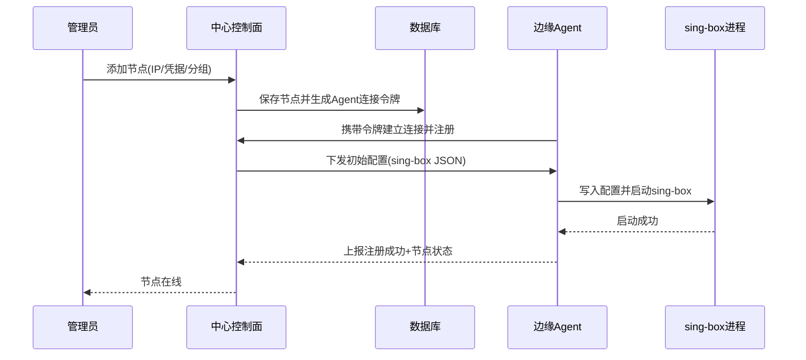
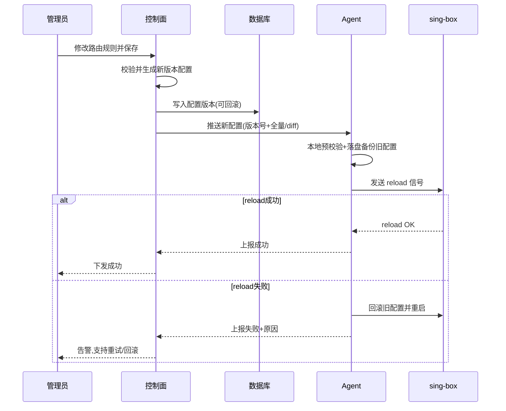
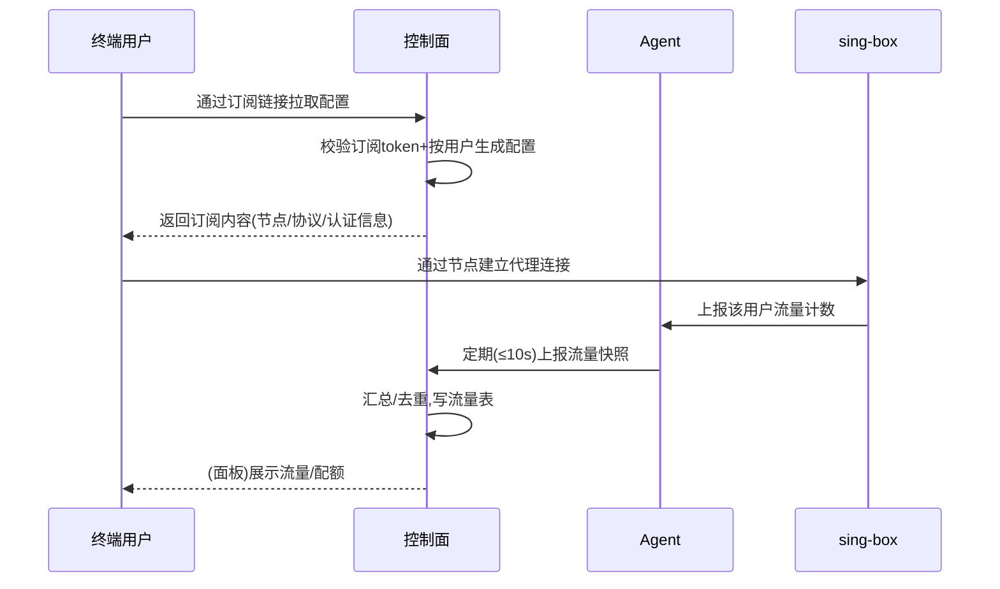

# 产品需求文档（PRD）：sing-box 企业级网络代理管理面板

## 一、项目信息

| 项 | 内容 |
|---|---|
| 文档语言 | 中文 |
| 产品名称 | sing-box 企业级网络代理管理面板 |
| Project Name | singbox_enterprise_panel |
| 后端技术栈 | Go + Gin/Fiber（已锁定） |
| 内核对接 | sing-box 外部二进制 + 进程托管（subprocess 启动/重启，reload 信号热更新）（已锁定） |
| 前端技术栈 | 响应式管理界面，前后端分离 |
| 部署场景 | 企业 / 多节点集群（中心控制面 + 边缘节点 Agent 拓扑） |

**原始需求**：参考 s-ui 面板设计理念，基于 sing-box 内核开发企业级 Web 网络代理服务管理面板，集中管理多台服务器上的 sing-box 节点，覆盖节点配置、inbound/outbound、路由规则、用户认证、流量统计与实时监控、订阅导入、节点测试、日志查看、RBAC 权限管理。

## 二、产品目标

1. **统一纳管多节点集群**：通过中心控制面统一管理分散在多台服务器上的 sing-box 边缘节点，实现配置集中编排、批量下发与版本管理。
   - 成功标准：新节点接入 ≤ 5 分钟；单次配置变更可批量下发 ≥ 100 节点，失败可重试/回滚。
2. **配置与状态可观测**：实时流量监控、节点健康状态、配置热更新与操作审计。
   - 成功标准：心跳/流量数据上报延迟 ≤ 10s；配置热更新生效 ≤ 5s；敏感操作 100% 留痕可审计。
3. **安全合规与权限可控**：RBAC 权限隔离、敏感信息加密存储、审计日志。
   - 成功标准：密钥/证书/TLS 私钥加密落库；RBAC 越权访问拦截率 100%。

## 三、目标用户与用户故事

| 角色 | 说明 | 权限级别 |
|---|---|---|
| 超级管理员（Super Admin） | 平台所有者，负责全局管理 | 全部权限 |
| 集群/区域管理员（Admin） | 管理所属集群/分组的节点与配置 | 管理所属分组 |
| 只读运维（Viewer/Ops） | 监控、查日志、查配置 | 只读 |
| 终端用户（End User） | 使用代理服务的订阅用户 | 自助订阅 |

用户故事：
1. 作为超级管理员，快速将新服务器上的 sing-box 接入面板，统一管理而不必手工 SSH 登录。
2. 作为集群管理员，通过可视化表单编辑 inbound/outbound 与路由规则并一键下发，降低 YAML 手工编辑出错率。
3. 作为只读运维，实时查看各节点流量、状态与日志，第一时间发现异常。
4. 作为集群管理员，为终端用户批量生成订阅链接并查看其流量。
5. 作为超级管理员，配置 RBAC 并查看审计日志，满足企业合规与安全要求。

## 四、需求池

优先级定义：P0 = MVP 必备；P1 = 重要能力；P2 = 增强能力。

### P0（MVP 必备）

| 编号 | 需求 | 需求描述 | 验收标准（AC） |
|---|---|---|---|
| REQ-001 | 节点接入与心跳 | 添加边缘节点（IP/host、Agent 连接凭据、分组），Agent 定期上报心跳与状态 | 可新增/删除/禁用节点；心跳超时阈值可配，超时标记离线并告警；在线/离线状态可见 |
| REQ-002 | Inbound 配置管理 | 可视化编辑入站：协议（vmess/vless/trojan/shadowsocks/hysteria2/tuic）、监听端口、transport、TLS | 增删改查；表单与 sing-box JSON 双向一致；端口冲突/非法配置保存前校验 |
| REQ-003 | Outbound 配置管理 | 管理出站：直连、代理链、落地节点、负载均衡 outbound | 增删改查；支持多 outbound 与策略组（selector/urltest） |
| REQ-004 | 路由规则配置 | 基于域名/IP/协议/端口/入站标签/用户等条件配置 routing rules | 规则增删改查并排序；下发后按序生效 |
| REQ-005 | 面板用户认证与登录 | 面板账号登录（用户名+密码）、会话管理 | 正确凭据登录、错误凭据拒绝；会话过期与登出；密码哈希存储 |
| REQ-006 | 代理用户认证 | 管理代理层用户（UUID/password），绑定节点或全局 | 增删改查；可绑定流量配额与过期时间 |
| REQ-007 | 订阅生成 | 为代理用户生成订阅链接/内容 | 生成可导入客户端的订阅 URL；订阅内容随配置变化自动更新 |
| REQ-008 | 配置下发与热更新 | 将控制面配置下发节点 Agent 并触发 sing-box reload | 下发成功/失败可追踪；失败可重试、可回滚上一版本 |
| REQ-009 | 流量统计（基础） | 按用户/节点统计上行/下行流量 | 可查用户与节点流量；数据误差 ≤ 1% |
| REQ-010 | RBAC（基础） | 角色（超管/管理员/只读）+ 资源级权限控制 | 越权访问被拒绝；只读用户无法执行写操作 |
| REQ-011 | 审计日志 | 记录登录、配置变更、节点操作、用户操作等关键操作 | 记录操作人/时间/动作/对象/结果/IP；可查询，普通管理员不可删除 |

### P1（重要）

| 编号 | 需求 | 需求描述 | AC |
|---|---|---|---|
| REQ-101 | 实时监控 | 节点 CPU/内存/连接数/实时速率，Dashboard 可视化 | 关键指标延迟 ≤ 10s；图表展示趋势 |
| REQ-102 | 订阅导入 | 从外部订阅链接导入节点/配置 | 支持标准订阅格式解析；冲突可预览并选覆盖策略 |
| REQ-103 | 节点测试 | 面板内发起连通性/延迟/可用性测试 | 单节点延迟与连通测试；展示结果 |
| REQ-104 | 日志查看 | 集中查看节点运行日志 | 按节点/级别/关键字过滤；支持动态调整日志级别 |
| REQ-105 | 证书管理 | TLS 证书托管与自动续期（ACME/Let's Encrypt） | 证书加密存储；到期告警与自动续期 |
| REQ-106 | 告警通知 | 节点离线、流量超限、证书到期告警 | 支持 Webhook/邮件通道；阈值可配 |
| REQ-107 | 配置版本管理 | 配置变更历史、对比与回滚 | 每次变更生成版本；可对比、可回滚 |
| REQ-108 | 批量操作 | 批量下发、批量重启、批量更新内核 | 批量任务进度与结果明细可见 |

### P2（增强）

| 编号 | 需求 | 描述 | AC |
|---|---|---|---|
| REQ-201 | 多租户 | 多租户隔离（企业-项目-集群多级） | 租户间数据隔离 |
| REQ-202 | OpenAPI/Webhook | 开放 REST API 供第三方/自动化集成 | 提供鉴权 API 与文档 |
| REQ-203 | 高可用控制面 | 控制面多副本 + 主备 | 控制面故障可切换 |
| REQ-204 | 深度流量分析 | 按协议/时段/来源维度分析报表 | 可导出报表 |
| REQ-205 | 内置订阅转换 | 生成 Clash/Stash 等不同客户端格式 | 支持多格式导出 |

## 五、核心业务流程

### 5.1 中心控制面与边缘节点 Agent 职责边界

| 关注点 | 中心控制面（Control Plane） | 边缘节点 Agent（Edge Agent） |
|---|---|---|
| 定位 | 单一管理入口，运行于中心服务器 | 部署于每台承载 sing-box 的服务器 |
| 职责 | 用户/RBAC/审计、配置编排与版本、订阅生成、流量汇总、监控展示、告警 | 托管 sing-box 进程（启停/重启/reload）、采集心跳与流量指标、拉取/接收配置、上报日志 |
| 不负责 | 直接处理代理数据面流量 | 面板认证、全局配置决策、订阅生成 |
| 数据方向 | 下发配置指令、用户/路由策略 | 上报心跳、状态、流量、日志 |
| 故障影响 | 控制面故障：节点继续按本地缓存配置运行，仅管理/统计受影响 | 节点故障：仅该节点中断，不影响控制面与其他节点 |

设计原则：控制面为「唯一事实源」，节点 Agent 落盘并本地缓存配置；断连时节点依赖本地缓存继续运行，保证数据面可用性。

### 5.2 节点接入与配置下发

### 5.3 配置热更新

### 5.4 用户订阅与流量统计

## 六、关键设计约束与非功能需求

### 6.1 安全与合规（代理面板重点）

| 类别 | 要求 |
|---|---|
| 访问控制 | 强制 RBAC + 最小权限；会话超时、失败登录锁定、可选 2FA；API 与订阅访问均需鉴权令牌 |
| 敏感信息存储 | TLS 私钥、证书、UUID、订阅令牌一律加密存储（AES-256-GCM 或 KMS），数据库不落明文；密码仅存哈希（bcrypt/argon2） |
| 审计日志 | 登录、配置变更、节点操作、用户增删、订阅生成全部留痕；日志防篡改（append-only/独立存储） |
| 传输安全 | 控制面 HTTPS；控制面↔Agent 通道 TLS + 双向认证（mTLS）或令牌校验 |
| 合规 | 支持按地区/分组做访问与日志隔离，满足数据驻留与合规审计要求；明确代理服务合规使用边界 |

### 6.2 性能
- 控制面：支持 ≥ 100 边缘节点、≥ 10 万代理用户，核心 API P95 ≤ 300ms
- 流量数据：按用户/节点聚合，支持小时/天/月时间窗口，查询 P95 ≤ 1s
- Agent 轻量：CPU 占用低，流量采集走 sing-box 统计 API，不侵入数据面

### 6.3 可扩展性
- 控制面无状态化（会话外置 Redis），支持水平扩容
- 数据库支持时序聚合（PostgreSQL + 时序表 或 ClickHouse）
- 配置模型与 sing-box JSON Schema 解耦，通过适配层兼容内核版本演进

### 6.4 多节点集群一致性
- 控制面为配置唯一事实源，节点最终一致，采用「版本号 + 确认回执」机制
- 下发支持幂等与重试，失败可回滚上一版本
- 心跳/流量上报去重与断点续传，避免重复计数

### 6.5 可维护性
- 全操作可视化留痕；配置变更版本化、可对比回滚
- Agent 支持远程升级/降级；日志统一结构化（JSON）

## 七、待确认问题

1. Agent 通信协议与方向：主动出站连接控制面（长连接/WebSocket/gRPC）还是控制面主动推送？是否要求跨 NAT？
2. 流量统计口径：是否需要真实用户级计费？计费与节点级统计的精度/审计要求？
3. sing-box 版本矩阵：需支持哪些内核版本与协议集（是否含 hysteria2、tuic、reality 等）？是否需兼容 s-ui 配置迁移？
4. 订阅协议：默认输出格式（sing-box 原生/Clash/Stash）？订阅令牌失效与轮换策略？
5. 多租户边界：MVP 是否需多租户，还是单组织多集群即可？
6. 认证集成：是否需对接企业 SSO（LDAP/OIDC）？2FA 是否 MVP 必备？
7. 合规地域：是否存在特定地区数据驻留/审计/实名要求？是否需要「禁止访问清单」能力？
8. 密钥托管：敏感信息加密是否允许外部 KMS/Vault，还是自托管加密？
9. 告警通道：P1 告警需要哪些通道（企业微信/邮件/Webhook）？
10. 高可用要求：控制面 HA 是否为上线硬性要求，还是 P2？

> 注：上述待确认问题中 1-9 项已由架构师在 `system_design.md` §10 给出推荐默认方案，第 10 项（HA）默认 P2。
