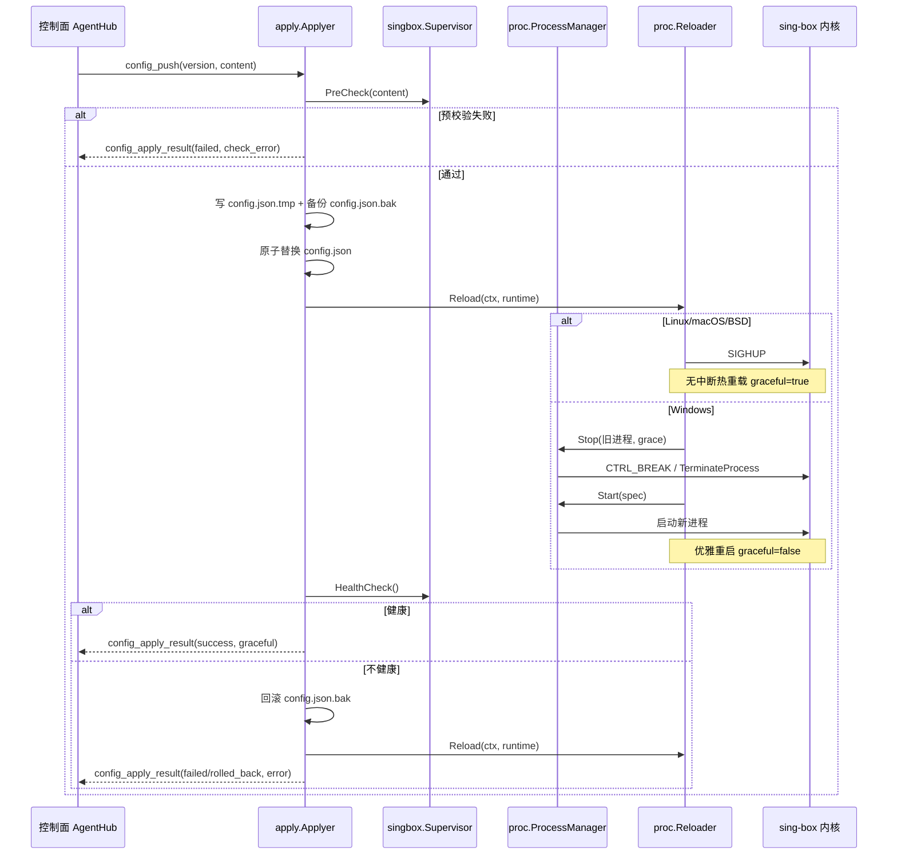
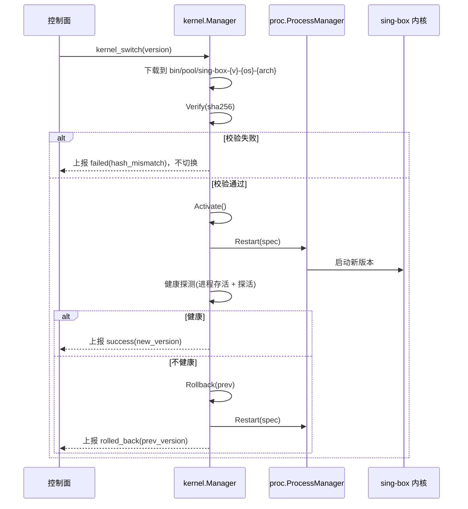
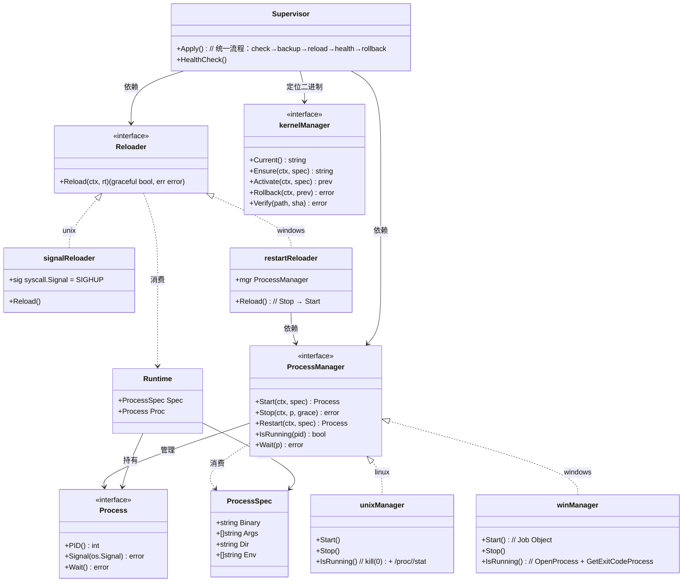

# 跨平台 Agent 部署 — 增量设计文档

> 架构师：高见远（Gao）
> 关联文档：`docs/system_design.md`（主设计）
> 范围：边缘 Agent 侧 OS 抽象层，屏蔽 Linux / Windows（及可选 darwin / freebsd）在**进程托管、reload 信号、文件路径、二进制选择**上的差异
> 结论前提：控制面 Go 单二进制、前端纯浏览器、Agent 交叉编译 + 主动出站 WS 长连接 → **跨平台部署本身天然成立**，本设计只补齐 Agent 侧的 OS 抽象封装。

---

## 0. 设计目标与原则

1. **一处抽象，两套实现**：用 Go 接口 `ProcessManager` / `Reloader` 屏蔽 OS 差异，上层 `apply` / `singbox` 只面向接口编程，不出现 `runtime.GOOS` 分支散落各处。
2. **孤儿进程零容忍**：Agent 无论正常退出还是崩溃（`kill -9` / `taskkill /F`），sing-box 子进程都必须被系统级回收（Linux `Pdeathsig`、Windows Job Object），不依赖 Agent 自身的 `defer` 清理。
3. **reload 语义统一，实现可降级**：上层 `apply` 永远走「预校验 → 备份 → 生效 → 健康探测 → 失败回滚」同一套流程；「生效」这一步在 Linux 上是 SIGHUP 热重载，在 Windows 上是「优雅重启」降级。
4. **内核二进制与版本治理集中到控制面**：Agent 不自行从公网拉内核，由控制面统一下发并校验 SHA-256，保证「同一节点组用同一内核版本」，升级/回滚可编排。

---

## 1. 进程托管 ProcessManager OS 抽象层

### 1.1 接口定义（`internal/proc/proc.go`）

```go
// internal/proc/proc.go
package proc

import (
	"context"
	"errors"
	"os"
	"time"
)

var (
	ErrAlreadyRunning = errors.New("proc: process already running")
	ErrNotRunning     = errors.New("proc: process not running")
	ErrStopTimeout    = errors.New("proc: stop grace expired, force killed")
)

// ProcessSpec 描述一个待启动的 sing-box 子进程
type ProcessSpec struct {
	Binary string   // 二进制绝对路径（由 kernel 包定位后传入）
	Args   []string // 如 ["run", "-c", configPath]
	Dir    string   // 工作目录（Agent 数据目录）
	Env    []string // 附加环境变量，K=V
}

// Process 已启动子进程的句柄（平台相关实现）
type Process interface {
	PID() int
	Signal(sig os.Signal) error // linux: SIGHUP/SIGTERM；windows: 有限支持（见下）
	Wait() error                // 阻塞等待退出，返回退出错误
}

// ProcessManager 进程托管抽象，屏蔽 Linux/Windows 差异
type ProcessManager interface {
	// Start 启动子进程，返回句柄；若已在运行返回 ErrAlreadyRunning
	Start(ctx context.Context, spec ProcessSpec) (Process, error)
	// Stop 优雅停止：先信号，超 grace 后强杀
	Stop(ctx context.Context, p Process, grace time.Duration) error
	// Restart 等价 Stop + Start（保留 spec）
	Restart(ctx context.Context, spec ProcessSpec) (Process, error)
	// IsRunning 判断 PID 对应进程是否存活（含僵尸态识别）
	IsRunning(pid int) bool
	// Wait 转发子进程 Wait，供 supervisor 监听意外退出
	Wait(p Process) error
}

// Runtime 描述 sing-box 当前运行上下文，供 Reloader 与 supervisor 共享
type Runtime struct {
	Spec ProcessSpec
	Proc Process // 当前进程句柄，nil 表示未运行
}

// NewManager / NewReloader 工厂：按 build tag 返回平台实现
func NewManager() ProcessManager                          { return newManager() }
func NewReloader(mgr ProcessManager) Reloader             { return newReloader(mgr) }
```

### 1.2 Linux 实现要点（`internal/proc/proc_unix.go`，`//go:build linux`）

```go
//go:build linux

package proc

import (
	"bytes"
	"context"
	"fmt"
	"os"
	"os/exec"
	"syscall"
	"time"
)

func newManager() ProcessManager { return &unixManager{} }

type unixManager struct{}

type unixProcess struct {
	cmd *exec.Cmd
	pid int
}

func (p *unixProcess) PID() int                  { return p.pid }
func (p *unixProcess) Signal(sig os.Signal) error { return p.cmd.Process.Signal(sig) }
func (p *unixProcess) Wait() error               { return p.cmd.Wait() }

func (m *unixManager) Start(ctx context.Context, spec ProcessSpec) (Process, error) {
	cmd := exec.CommandContext(ctx, spec.Binary, spec.Args...)
	cmd.Dir = spec.Dir
	cmd.Env = append(os.Environ(), spec.Env...)
	// 关键：独立会话/进程组 + 父进程死亡信号
	cmd.SysProcAttr = &syscall.SysProcAttr{
		Setpgid:   true,             // 新进程组，便于按组发信号（负 PID）
		Setsid:    true,             // 新会话，脱离 Agent 会话，避免终端 Ctrl+C 误伤
		Pdeathsig: syscall.SIGTERM,  // 父进程(Agent)死亡 → 内核自动 SIGTERM 子进程
	}
	if err := cmd.Start(); err != nil {
		return nil, err
	}
	return &unixProcess{cmd: cmd, pid: cmd.Process.Pid}, nil
}

func (m *unixManager) Stop(ctx context.Context, p Process, grace time.Duration) error {
	up := p.(*unixProcess)
	_ = syscall.Kill(up.pid, syscall.SIGTERM) // 优雅终止
	done := make(chan error, 1)
	go func() { done <- up.cmd.Wait() }()
	select {
	case <-done:
		return nil
	case <-time.After(grace):
		_ = syscall.Kill(-up.pid, syscall.SIGKILL) // 负 PID → 整组强杀
		<-done
		return ErrStopTimeout
	}
}

func (m *unixManager) Restart(ctx context.Context, spec ProcessSpec) (Process, error) {
	// 简化实现：由上层先 Stop 旧进程再 Start；此处仅按 pid 文件兜底清理
	if pid := readPidFile(); pid > 0 && m.IsRunning(pid) {
		_ = syscall.Kill(pid, syscall.SIGTERM)
		time.Sleep(300 * time.Millisecond)
	}
	return m.Start(ctx, spec)
}

func (m *unixManager) IsRunning(pid int) bool {
	// 1) signal 0 探测进程存在
	if err := syscall.Kill(pid, 0); err != nil {
		return false
	}
	// 2) 读 /proc/<pid>/stat 排除僵尸态（stat 第 3 字段 = 状态字母）
	data, err := os.ReadFile(fmt.Sprintf("/proc/%d/stat", pid))
	if err != nil {
		return false
	}
	fields := bytes.Fields(data)
	return len(fields) > 2 && string(fields[2]) != "Z"
}

func (m *unixManager) Wait(p Process) error { return p.(*unixProcess).cmd.Wait() }
```

**Linux 关键差异总结**：

| 能力 | 实现方式 |
|---|---|
| 启动 | `os/exec` + `SysProcAttr{Setsid, Setpgid, Pdeathsig}` |
| 优雅停止 | `SIGTERM` → 等待 → 超时 `SIGKILL`（整组 `-pid`） |
| 热重载 | `SIGHUP`（见 §2） |
| 状态检查 | `kill(pid, 0)` + `/proc/<pid>/stat` 排除僵尸态 |
| 孤儿回收 | `Pdeathsig=SIGTERM`（内核级父死子亡）+ PID 文件启动时对账 |

### 1.3 Windows 实现要点（`internal/proc/proc_windows.go`，`//go:build windows`）

```go
//go:build windows

package proc

import (
	"context"
	"os"
	"os/exec"
	"syscall"
	"time"
	"unsafe"

	"golang.org/x/sys/windows"
)

func newManager() ProcessManager { return &winManager{} }

type winManager struct{}

type winProcess struct {
	cmd *exec.Cmd
	pid int
	job windows.Handle // Job Object，用于 KILL_ON_JOB_CLOSE
}

func (p *winProcess) PID() int                   { return p.pid }
func (p *winProcess) Signal(sig os.Signal) error { return p.cmd.Process.Signal(sig) }
func (p *winProcess) Wait() error                { return p.cmd.Wait() }

func (m *winManager) Start(ctx context.Context, spec ProcessSpec) (Process, error) {
	cmd := exec.CommandContext(ctx, spec.Binary, spec.Args...)
	cmd.Dir = spec.Dir
	cmd.Env = append(os.Environ(), spec.Env...)
	cmd.SysProcAttr = &syscall.SysProcAttr{
		CreationFlags: syscall.CREATE_NEW_PROCESS_GROUP, // 独立进程组，可收 CTRL_BREAK
	}
	if err := cmd.Start(); err != nil {
		return nil, err
	}

	// 关键：挂到 Job Object，KILL_ON_JOB_CLOSE 保证 Agent 退出/崩溃时子进程被系统回收
	wp := &winProcess{cmd: cmd, pid: cmd.Process.Pid}
	job, err := windows.CreateJobObject(nil, nil)
	if err == nil {
		info := windows.JOBOBJECT_EXTENDED_LIMIT_INFORMATION{}
		info.BasicLimitInformation.LimitFlags = windows.JOB_OBJECT_LIMIT_KILL_ON_JOB_CLOSE
		if _, err := windows.SetInformationJobObject(
			job,
			windows.JobObjectExtendedLimitInformation,
			uintptr(unsafe.Pointer(&info)),
			uint32(unsafe.Sizeof(info)),
		); err == nil {
			if windows.AssignProcessToJobObject(job, windows.Handle(cmd.Process.Handle)) == nil {
				wp.job = job
			}
		}
	}
	return wp, nil
}

func (m *winManager) Stop(ctx context.Context, p Process, grace time.Duration) error {
	wp := p.(*winProcess)
	// 1) 尽力优雅：向进程组发 CTRL_BREAK（仅当 sing-box 附着控制台时有效）
	_ = windows.GenerateConsoleCtrlEvent(windows.CTRL_BREAK_EVENT, uint32(wp.pid))
	done := make(chan error, 1)
	go func() { done <- wp.cmd.Wait() }()
	select {
	case <-done:
		return nil
	case <-time.After(grace):
		// 2) 超时强杀
		_ = windows.TerminateProcess(windows.Handle(wp.cmd.Process.Handle), 1)
		<-done
		return ErrStopTimeout
	}
}

func (m *winManager) Restart(ctx context.Context, spec ProcessSpec) (Process, error) {
	// 同上：上层负责 Stop 旧进程后再 Start
	return m.Start(ctx, spec)
}

func (m *winManager) IsRunning(pid int) bool {
	h, err := windows.OpenProcess(windows.SYNCHRONIZE, false, uint32(pid))
	if err != nil {
		return false // 进程不存在（ERROR_INVALID_PARAMETER）
	}
	defer windows.CloseHandle(h)
	var code uint32
	if err := windows.GetExitCodeProcess(h, &code); err != nil {
		return false
	}
	return code == windows.STILL_ACTIVE // 259
}

func (m *winManager) Wait(p Process) error { return p.(*winProcess).cmd.Wait() }
```

**Windows 关键差异总结**：

| 能力 | 实现方式 |
|---|---|
| 启动 | `os/exec` + `CREATE_NEW_PROCESS_GROUP` + **Job Object** |
| 优雅停止 | `GenerateConsoleCtrlEvent(CTRL_BREAK_EVENT)` → 等待 → 超时 `TerminateProcess` |
| 热重载 | **无 SIGHUP**，降级为「优雅重启」（见 §2） |
| 状态检查 | `OpenProcess(SYNCHRONIZE)` + `GetExitCodeProcess == STILL_ACTIVE`（等价 `tasklist` 语义，句柄方式更稳） |
| 孤儿回收 | Job Object `JOB_OBJECT_LIMIT_KILL_ON_JOB_CLOSE`（句柄关闭即杀，Agent 崩溃也生效） |

> **注意**：Windows 上 `GenerateConsoleCtrlEvent` 只对**拥有控制台**的进程组有效。若 Agent 以 Windows 服务（无控制台）运行，CTRL_BREAK 无法送达，`Stop` 会在 grace 超时后落到 `TerminateProcess`。故 Windows 下 sing-box 的「优雅退出」本质上是尽力而为，最终以强杀兜底。该差异已由统一 apply 流程（§2.3）的健康探测 + 回滚机制对冲。

### 1.4 孤儿进程回收（核心问题）

| 场景 | Linux | Windows |
|---|---|---|
| Agent **正常退出**（走 `Stop`） | `Stop` 显式 SIGTERM/SIGKILL，无残留 | `Stop` 显式 CTRL_BREAK/TerminateProcess，无残留 |
| Agent **异常崩溃**（`kill -9`） | `Pdeathsig=SIGTERM` 由**内核**在父进程死亡时自动发给子进程 | Job Object `KILL_ON_JOB_CLOSE` 在 Agent 所有句柄关闭时由**内核**杀子进程 |
| Agent **重启后对账** | 读 `run/sing-box.pid`，`IsRunning` 若存活且不属于本实例 → 先 SIGTERM 再接管 | 同左，用 `OpenProcess` 对账，`TerminateProcess` 接管 |

**结论**：两条 OS 路径都用「内核级回收机制 + 启动对账」双重兜底，不依赖 `defer`（进程崩溃时 `defer` 根本不执行）。Agent 侧还通过 `run/agent.lock`（文件锁）保证单节点同一时刻只有一个 Agent 实例托管内核，避免双实例竞态。

---

## 2. reload 信号抽象

### 2.1 Windows 下 sing-box 是否支持 signal reload —— 明确判断

> **判断结论**：**Windows 下 sing-box 不支持 SIGHUP 信号热重载**。
>
> 依据：sing-box 内核的热重载依赖 Unix 信号 `SIGHUP`（其 `run` 命令通过 Go `os/signal` 监听 `syscall.SIGHUP/SIGTERM/SIGINT`）。而 Windows 无 POSIX `SIGHUP`，Go 在 Windows 编译目标下 `syscall.SIGHUP` 不可用，`os/signal` 仅支持 `os.Interrupt`（Ctrl+C/Ctrl+Break），无法等价表达「reload 而不退出」的语义。
>
> 因此 Windows 上的唯一可行路径是**降级为「优雅重启」**：备份配置 → 停旧进程 → 起新进程。代价是配置变更期间有秒级连接中断。
>
> **标注**：sing-box 版本演进较快，不排除未来官方引入「API 触发 reload」或 Windows 专用重载机制；是否新增，须以**锁定内核版本**实测 `sing-box run` 的 reload 行为为准（验收点在 T03 补充，见 §5.3）。

### 2.2 Reloader 接口（`internal/proc/reload.go`）

```go
// internal/proc/reload.go
package proc

import "context"

// Reloader 抽象「让 sing-box 使用新配置生效」的动作，屏蔽 SIGHUP 与无信号差异
type Reloader interface {
	// Reload 使运行中的进程加载新配置。
	// graceful=true 表示无中断热重载（SIGHUP）；
	// graceful=false 表示平台不支持，已降级为「优雅重启」（Stop 旧进程 → Start 新进程）。
	// 返回错误时上层走统一回滚流程。
	Reload(ctx context.Context, rt *Runtime) (graceful bool, err error)
}
```

**Linux / darwin / freebsd 实现（信号热重载）**：

```go
//go:build linux || darwin || freebsd

package proc

import (
	"context"
	"syscall"
)

func newReloader(mgr ProcessManager) Reloader {
	return &signalReloader{sig: syscall.SIGHUP}
}

type signalReloader struct{ sig syscall.Signal }

func (r *signalReloader) Reload(ctx context.Context, rt *Runtime) (bool, error) {
	if rt.Proc == nil {
		return false, ErrNotRunning
	}
	if err := rt.Proc.Signal(r.sig); err != nil {
		return false, err
	}
	return true, nil // 无中断热重载
}
```

**Windows 实现（优雅重启降级）**：

```go
//go:build windows

package proc

import (
	"context"
	"time"
)

const stopGrace = 10 * time.Second

func newReloader(mgr ProcessManager) Reloader { return &restartReloader{mgr: mgr} }

type restartReloader struct{ mgr ProcessManager }

func (r *restartReloader) Reload(ctx context.Context, rt *Runtime) (bool, error) {
	if rt.Proc != nil {
		if err := r.mgr.Stop(ctx, rt.Proc, stopGrace); err != nil {
			return false, err
		}
	}
	p, err := r.mgr.Start(ctx, rt.Spec)
	if err != nil {
		return false, err
	}
	rt.Proc = p
	return false, nil // graceful=false：走了重启式
}
```

### 2.3 Agent `apply` 统一流程

无论 Linux 还是 Windows，`internal/apply` 走完全相同的流程，只把「生效」一步委托给 `Reloader`：

```
预校验(sing-box check -c)
   → 备份(config.json → config.json.bak)
   → 写入新配置
   → Reloader.Reload()   [Linux: SIGHUP 热重载 / Windows: Stop→Start 重启]
   → 健康探测(进程存活 + 探活)
   → 成功: 上报 success(graceful 标记)
   → 失败: 回滚(恢复 .bak → 再次 Reload) → 上报 failed/rolled_back
```



> `config_apply_result` 增加 `graceful` 字段，让控制面可区分「热重载」与「重启式」，用于审计与监控（重启式下发期间连接有抖动，需在节点详情/告警中体现）。

---

## 3. 二进制路径选择与内核版本管理

### 3.1 定位与选择逻辑

- 二进制三元组 `Spec{OS, Arch, Version}`：`OS/Arch` 由 `runtime.GOOS/GOARCH` 自动探测（Agent 自身编译目标决定），`Version` 由控制面下发。
- 路径命名：`sing-box-{os}-{arch}` 作为「角色路径」固定不变（`supervisor` 无需感知版本号），实际内容通过版本池 + 软链/指针切换，实现「升级不换路径、回滚即换指针」。

### 3.2 推荐目录布局（Agent 数据目录）

```
<agent-datadir>/                    # Linux: /opt/singbox-agent/  Windows: C:\ProgramData\singbox-agent\
├── bin/
│   ├── current/                    # 激活版本（软链或复制）
│   │   └── sing-box-{os}-{arch}    # 固定角色路径，supervisor 始终启动它
│   ├── pool/                       # 版本池（不可变，哈希校验后落盘）
│   │   ├── sing-box-1.11.4-{os}-{arch}
│   │   └── sing-box-1.11.5-{os}-{arch}
│   └── checksums/
│       └── manifest.json           # {version: sha256, 来源, 时间}
├── etc/
│   ├── config.json                 # 当前 sing-box 配置
│   ├── config.json.bak             # 上一版本备份
│   └── agent.yaml                  # Agent 自身配置（新增内核相关键）
├── run/
│   ├── sing-box.pid                # PID 文件（启动对账用）
│   └── agent.lock                  # 文件锁，防双实例
└── logs/
    └── sing-box.log                # 内核日志重定向
```

> 说明：`bin/current/sing-box-{os}-{arch}` 固定为 supervisor 的启动路径；`pool/` 中每个版本文件不可变，升级 = 下载到 `pool/` + 校验 + 原子切换 `current` 指针。这样回滚只是「切回上一个指针」，不会产生半更新状态。

### 3.3 内核二进制下发与校验机制

- **控制面**新增 `kernel_release` 表：`(os, arch, version, sha256, size, url, enabled, created_at)`；内核二进制文件托管在控制面对象存储 / 本地 `kernels/` 目录。
- **控制面**新增接口：
  - `GET /api/v1/kernels?os=&arch=&version=` — 查询可用版本（含 `sha256`）。
  - `GET /api/v1/kernels/download?os=&arch=&version=` — 下载二进制，响应头带 `X-Sha256`（Agent 令牌鉴权；也可复用 WS 通道下发二进制分片）。
- **Agent** 侧 `internal/kernel.Manager` 职责：

```go
// internal/kernel/manager.go
package kernel

import "context"

// Spec 内核目标三元组
type Spec struct {
	OS      string // linux / windows / darwin / freebsd（= runtime.GOOS）
	Arch    string // amd64 / arm64 / arm / mips / mipsle（= runtime.GOARCH）
	Version string // 如 1.11.4
}

// Manager 内核二进制定位 / 下载 / 校验 / 切换
type Manager interface {
	// Current 返回当前激活二进制的绝对路径（bin/current/sing-box-{os}-{arch}）
	Current() (string, error)
	// Ensure 确保本地存在 Spec 对应二进制并通过 SHA-256 校验，缺失则触发下载
	Ensure(ctx context.Context, spec Spec) (string, error)
	// Activate 原子切换激活版本，返回旧版本路径用于回滚
	Activate(ctx context.Context, spec Spec) (prev string, err error)
	// Rollback 回滚到 previous 路径
	Rollback(ctx context.Context, prev string) error
	// Verify 校验文件 SHA-256
	Verify(path, wantSHA256 string) error
}
```

- **注册握手**：Agent `register` 消息的 `hostinfo` 增加 `os/arch/libc` 字段，控制面据此返回「应使用的内核版本」（可配置为「分组级内核版本策略」，如固定 latest / 固定 pin 版本）。

### 3.4 版本升级 / 降级 / 回滚流程



- **升级**：`Ensure(新版本)` → `Activate` → `Restart` → 健康探测。
- **降级/回滚**：`Activate(历史版本)` 或 `Rollback(prev)` → `Restart` → 健康探测。因 `pool/` 保留多版本，回滚即「换指针」，无需重新下载。
- **清理策略**：`pool/` 仅保留最近 N 个版本（如 3 个），其余 GC；`current` 与 `config.json.bak` 永不参与 GC。

---

## 4. 交叉编译目标矩阵

### 4.1 目标矩阵

| GOOS | GOARCH | Agent 支持 | sing-box 官方预编译 | 典型部署场景 | 备注 |
|---|---|---|---|---|---|
| linux | amd64 | ✅ P0 | ✅（含 amd64v3 优化版） | VPS、x86_64 家用软路由、落地机 | 默认主力目标 |
| linux | arm64 | ✅ P0 | ✅ | 树莓派 4/5、ARM VPS、ARM NAS、新 OpenWrt | 主力目标 |
| linux | arm (v7) | ✅ P0 | ✅（armv7；armv6 需自编译） | 老树莓派、armv7 软路由/电视盒 | `GOARM=7` |
| linux | mips | ✅ P1 | ✅（softfloat） | OpenWrt MT7621 大端设备 | `GOMIPS=softfloat` |
| linux | mipsle | ✅ P1 | ✅（softfloat） | OpenWrt MT7621 小端设备（更常见） | `GOMIPS=softfloat` |
| linux | mips64 / mips64le | ⚠️ P2 可选 | ✅ | 少见，可后补 | 按需开启 |
| windows | amd64 | ✅ P0 | ✅ | Windows Server 落地机 / Windows 客户端 | reload 为重启式（§2） |
| windows | arm64 | ✅ P0 | ✅ | Windows on ARM | reload 为重启式 |
| darwin | amd64 | ⚠️ P2 可选 | ✅ | macOS Intel 开发机/落地 | 仅本地/开发验证 |
| darwin | arm64 | ⚠️ P2 可选 | ✅ | macOS Apple Silicon | 仅本地/开发验证 |
| freebsd | amd64 | ⚠️ P2 可选 | ✅ | FreeBSD 落地机 | **需用户拍板是否纳入** |
| linux | riscv64 / s390x / ppc64le | ❌ P2+ 未纳入 | ✅ | 极小众 | 首版不覆盖 |

> **说明**：
> 1. 「sing-box 官方预编译」列基于其 GitHub Release 的常规资产清单判断；**确切资产名（如 `linux-armv7`、`linux-mipsle`）须以锁定的内核版本 release 页为准**，在控制面 `kernel_release` 表中登记实际可下载资产。
> 2. Agent 为纯 Go（仅依赖 stdlib + `golang.org/x/sys`，Windows Job Object 等均为纯 Go syscall 封装），`CGO_ENABLED=0` 可静态编译，交叉编译成本极低。

### 4.2 构建方式

**GoReleaser matrix 构建**（推荐，产物命名/校验/上传一条龙）：

```yaml
# .goreleaser.yaml（edge-agent）
builds:
  - id: edge-agent
    main: ./cmd/agent
    binary: singbox-agent
    env:
      - CGO_ENABLED=0
    goos: [linux, windows, darwin, freebsd]
    goarch: [amd64, arm64, arm, mips, mipsle]
    goarm: ["7"]          # armv7；如需 armv6 追加 "6"
    gomips: [softfloat]   # mips/mipsle 软浮点，兼容无 FPU 的 OpenWrt
    ldflags:
      - -s -w -X main.version={{.Version}} -X main.commit={{.ShortCommit}}
    ignore:               # 排除无意义组合
      - goos: windows
        goarch: [arm, mips, mipsle]
      - goos: darwin
        goarch: [arm, mips, mipsle]
      - goos: freebsd
        goarch: [arm, mips, mipsle]

archives:
  - format: tar.gz
    name_template: "{{ .ProjectName }}-{{ .Version }}-{{ .Os }}-{{ .Arch }}"

checksum:
  name_template: "checksums.txt"
```

**Makefile 单目标构建**（本地/CI 调试用）：

```makefile
GOOS ?= linux
GOARCH ?= amd64
GOARM ?= 7
GOMIPS ?= softfloat
VERSION ?= dev

build-agent:
	CGO_ENABLED=0 GOOS=$(GOOS) GOARCH=$(GOARCH) GOARM=$(GOARM) GOMIPS=$(GOMIPS) \
		go build -trimpath -ldflags "-s -w -X main.version=$(VERSION)" \
		-o dist/singbox-agent-$(GOOS)-$(GOARCH) ./cmd/agent

release-agent:
	goreleaser release --snapshot --clean
```

---

## 5. 对既有设计的影响

### 5.1 Agent 目录结构调整

原设计（`system_design.md` §3.2）：

```
edge-agent/internal/
├── config/  client/  singbox/  apply/  stats/  secret/
```

调整为（**新增两个包 + 一个轻量 host 探测**，`singbox/`、`apply/` 内部改造）：

```
edge-agent/internal/
├── config/                     # agent 自身配置（新增 kernel 相关键，见 5.2）
├── client/                     # 不变：WS 客户端
├── proc/                       # ★新增：OS 抽象（ProcessManager/Reloader/Process/Spec）
│   ├── proc.go                 #   接口 + 工厂 + Runtime
│   ├── proc_unix.go            #   linux 实现（//go:build linux）
│   ├── proc_windows.go         #   windows 实现（//go:build windows）
│   └── reload.go               #   Reloader 接口 + signal/restart 两实现（build tag）
├── kernel/                     # ★新增：内核版本管理（定位/下载/校验/切换/回滚）
│   └── manager.go
├── host/                       # ★新增：OS/ARCH/libc 探测（register 的 hostinfo）
│   └── host.go
├── singbox/                    # 改造：process.go 改为 supervisor，调用 proc + kernel
│   ├── supervisor.go           #   托管生命周期：Start/Stop/Restart/HealthCheck/WaitLoop
│   └── check.go                #   sing-box check -c 封装
├── apply/                      # 改造：apply.go 走统一流程，调用 supervisor.Reload()
│   └── apply.go
├── stats/                      # 不变
└── secret/                     # 不变
```

**变化点**：
- `internal/singbox/process.go`（原）不再直接 `os/exec` 拼命令，改为「`supervisor` 面向 `proc.ProcessManager` + `proc.Reloader` 编程」，OS 分支全部下沉到 `internal/proc`。
- `internal/apply/apply.go`（原）保留预校验/备份/回滚编排，把「reload」与「重启」统一委托 `Reloader.Reload`，并新增 `graceful` 上报字段。

### 5.2 Agent 配置新增键（`internal/config`）

```yaml
agent:
  datadir: /opt/singbox-agent        # 数据目录（§3.2 布局）
  kernel:
    os: auto                         # 默认 runtime.GOOS
    arch: auto                       # 默认 runtime.GOARCH
    version: ""                      # 空=跟随控制面下发
    download_url: ""                 # 控制面内核下载地址（或走 WS 下发）
  proc:
    stop_grace: 10s                  # Stop 优雅超时
    health_interval: 3s              # 健康探测间隔
```

### 5.3 任务列表 T03 验收标准补充

原 T03 验收点（下发→预校验→备份→写盘→reload→健康校验→成功/失败回滚）保持不变，**追加以下跨平台验收点**：

| # | 新增验收点 | 判定标准 |
|---|---|---|
| 1 | 注册上报主机信息 | `register.hostinfo` 含 `os/arch/libc`，控制面据此选择内核与配置 |
| 2 | Linux 热重载 | SIGHUP 触发，生效 ≤5s，**不中断**既有连接，`graceful=true` |
| 3 | Windows 重启式降级 | Stop→Start 生效，`graceful=false`，节点详情/审计可区分 |
| 4 | 孤儿进程回收 | Linux `kill -9` Agent 后 sing-box 自动退出（Pdeathsig）；Windows `taskkill /F` Agent 后 sing-box 退出（Job Object） |
| 5 | 内核版本切换 | 下载→SHA-256 校验→激活→健康探测→失败回滚可用 |
| 6 | 交叉编译产物 | CI 至少产出 linux/amd64、linux/arm64、linux/armv7、windows/amd64、windows/arm64 五类 Agent 二进制 |
| 7 | 双实例互斥 | `run/agent.lock` 保证同节点只有一个 Agent 托管内核 |

### 5.4 需用户拍板的新决策点

| # | 决策点 | 推荐默认 | 影响 |
|---|---|---|---|
| 1 | **Windows reload 是否接受「重启式」降级** | ✅ 接受（Windows 无 SIGHUP，无中断热重载不可行） | 若要求无中断，需等 sing-box 内核提供 API reload 并实测；否则 Windows 节点下发期间有秒级抖动 |
| 2 | **是否 MVP 纳入 freebsd** | ❌ 不纳入，P2 可选 | 交叉编译成本低，但验收/测试矩阵扩大，默认仅 Linux+Windows 进入 T03 验收 |
| 3 | **是否首版覆盖 mips/mipsle（OpenWrt 软路由）** | ✅ 建议覆盖 | 家用软路由是高频落地场景，`GOMIPS=softfloat` 构建成本低；若不覆盖则该场景缺位 |
| 4 | **内核二进制是否由控制面统一下发** | ✅ 控制面统一托管（版本治理 + SHA-256） | 若允许 Agent 直连 GitHub 拉内核，则版本一致性/签名治理/内网可达性都变难，不推荐 |
| 5 | **内核版本策略** | 分组级 pin 版本（不自动追 latest） | 避免内核升级导致 Schema/配置不兼容；由控制面显式下发目标版本 |

---

## 6. 关键类关系图


