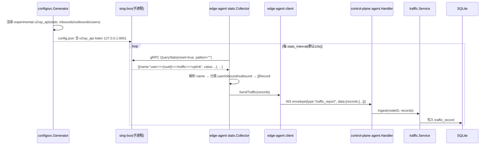
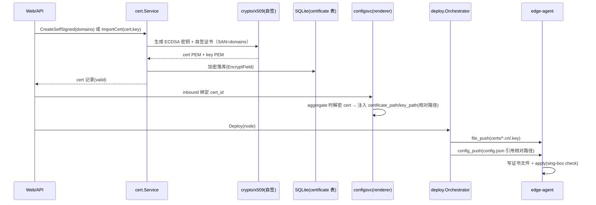
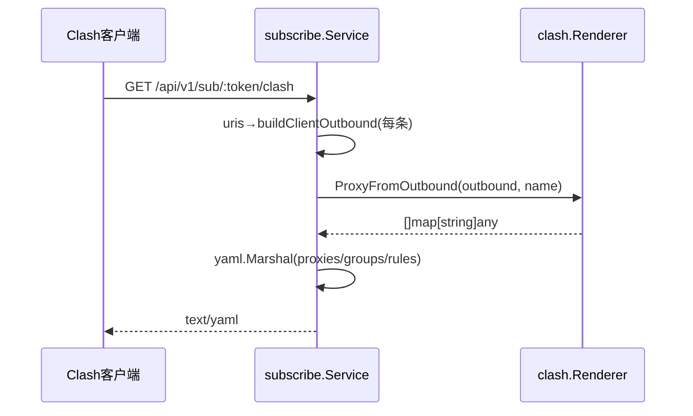
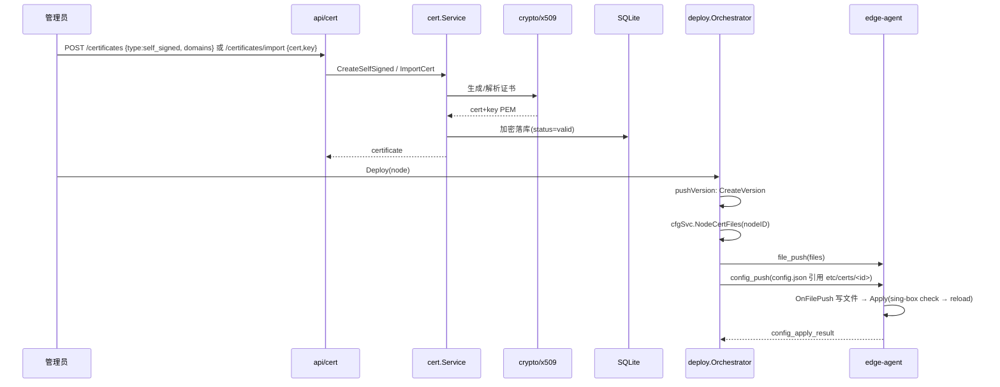
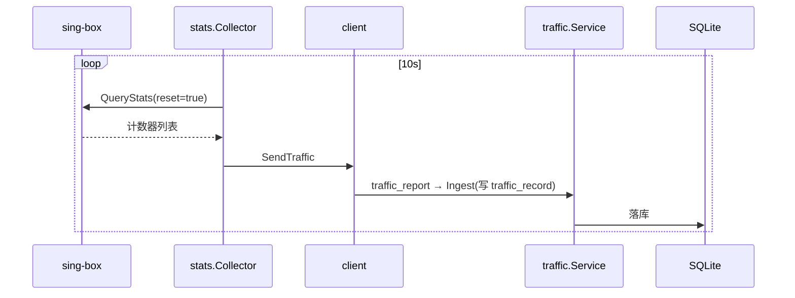
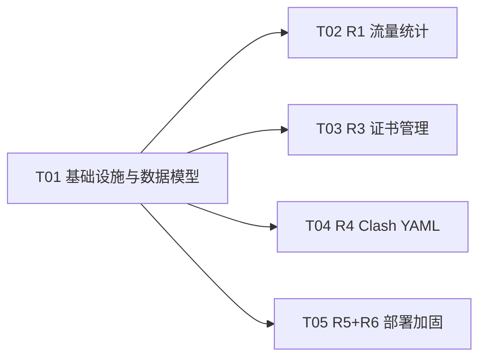

# S-UI 功能补齐 · 系统设计与任务分解（yc-box）

> 架构师：高见远 · 输入：`docs/sui-gap-prd.md`（产品经理许清楚） · 目标读者：工程师寇豆码
> 本文档在**主理人已核实的代码事实**基础上设计，覆盖 P0(R1/R3) 详细方案 + P1(R4/R5/R6) 方案 + P2(R7-R10) 简述。
> 修订记录：R2 限速经用户决策 **descope**（不做任何限速）；R3 证书经用户决策改为 **自签 + 手动导入**（不用 ACME）。

---

## 0. 关键结论（先读）

| # | 结论 | 影响 |
|---|---|---|
| 1 | **sing-box v2ray_api 是 gRPC 接口，不是 HTTP**（`stats.go` stub 注释 `GET /traffic` 有误）。R1 采集需用 gRPC 客户端调 `StatsService/QueryStats`。 | 需在 edge-agent 引入 gRPC + 最小化 proto |
| 2 | **R2 限速已 descope**（用户：「不做任何限速，所有协议跑最快」）。QuotaBytes/ExpireAt/UsedBytes 为既有字段保留不动，但**不做任何执行/拦截动作**。 | 不新增字段、不做 EnforceQuotas/quotaLoop/禁用重下发 |
| 3 | 证书需**跨机下发**：sing-box TLS 只认 `certificate_path/key_path` 文件路径，故新增 WS 消息 `file_push`（控制面→Agent）。 | 协议新增 1 条消息 |
| 4 | 流量"用户↔记录"映射：sing-box 用户 `name` 改为 **proxy_user 的 DB UUID**，采集端解析 `user>>>{uuid}` 直接得到用户 ID。 | 改 2 处 name 生成 + 1 处解析 |
| 5 | 5 个任务：`T01 基础设施` → {`T02 R1 流量`, `T03 R3 证书`, `T04 R4 Clash`, `T05 R5+R6`}。 | 见 §6/§7 |

---

## 1. 实现方案

### 1.1 R1 实时流量统计（P0）

#### 1.1.1 数据流



#### 1.1.2 改动文件（精确到函数/struct）

**edge-agent（采集端，主战场）**

| 文件 | 改动 |
|---|---|
| `edge-agent/internal/stats/stats.go` | **重写 `Collector.Collect(ctx)`**：由"返回 nil"改为 gRPC 客户端调 `QueryStats(reset=true)`，解析 `>>>` 分隔的计数器名，产出 `[]Record`。`Record.ProxyUserID` 语义改为 **proxy_user DB UUID 字符串**。`statsAPI` 由 `NewCollector` 传入（已有字段保留）。 |
| `edge-agent/internal/stats/proto/command.proto`（新增） | 最小化 v2ray stats proto（见 §3.3），只保留 `StatsService.QueryStats` + `QueryStatsRequest/Response` + `Stat`。 |
| `edge-agent/internal/stats/proto/command.pb.go` / `command_grpc.pb.go`（生成） | 由 protoc 生成，入库。 |
| `edge-agent/internal/client/client.go` | 新增常量 `msgTrafficReport = "traffic_report"`；新增 `TrafficReportData` 结构；新增导出方法 `SendTraffic(records []stats.Record) error`（复用 `send`）。 |
| `edge-agent/internal/config/config.go` | `AgentConfig` 新增 `StatsAPI string`、`StatsInterval time.Duration`、`StatsEnabled bool`；`setDefaults` + `applyDerivedDefaults` 补默认值 `127.0.0.1:9001` / `10s` / `true`。 |
| `edge-agent/cmd/agent/main.go` | 装配 `stats.NewCollector(cfg.Agent.StatsAPI)`；新增 goroutine `trafficLoop(ctx, cli, collector, interval)`：周期 `Collect` → `cli.SendTraffic`；随 `ctx` 取消退出。 |

**control-plane（渲染 + 摄入收尾）**

| 文件 | 改动 |
|---|---|
| `control-plane/internal/configsvc/generator.go` | `Generate` 在拼装 `doc` 前收集 `inboundTags/outboundTags/userNames`（`enabledInbounds[].Name`、`enabledOutbounds[].Name`、`ctx.ProxyUsers[].Name`），新增 `doc["experimental"]`（见 §3.2）。 |
| `control-plane/internal/configsvc/entity.go` | `decryptProxyUser`：`pu.Name` 由 `"user-"+firstN(plain,4)` 改为 `u.ID.String()`（DB UUID）。 |
| `control-plane/internal/subscribe/service.go` | `uris` 中 `pu.Name` 同步改为 `u.ID.String()`（Name 仅作 sing-box 用户标识，不进入订阅 URI fragment）。 |
| `control-plane/internal/traffic/service.go` | `resolveByUUID` → **`resolveByID(ctx, idStr string)`**：直接 `uuid.Parse`，删除解密遍历；`Ingest` 同步调用。 |

> 说明：control-plane 侧 `agent.MsgTrafficReport`、`TrafficReportData`、handler 分发、`main.go` 回调接线**已存在**（见 `agent/message.go`、`agent/handler.go:196`、`cmd/server/main.go:113`），无需新建，只改采集端与映射语义。`proxy_user.used_bytes` 为既有字段，本需求**不累加、不判定**（R2 已 descope）。

#### 1.1.3 采集周期与 SQLite 表结构
- 采集周期默认 **10s**（`agent.stats_interval`），满足"误差 < 采集周期"。
- `traffic_record` 表**不改结构**（组合主键 `ts,node_id,inbound_tag,outbound_tag` 保留）；采用**哨兵 tag** 归并三类计数器（见 §3.4）。

### 1.2 R2 单连接限速 + 配额到期执行（P0 → 已 descope）

**用户决策**：「不做任何限速，要让所有的协议可以跑的最快」。

- **不新增** `SpeedLimitDown/UpMbps` 字段。
- **不做** `EnforceQuotas`、`quotaLoop`、`DisabledReason`、禁用重下发、restart 断流等任何执行/拦截动作。
- `QuotaBytes`（-1=无限）、`UsedBytes`、`ExpireAt` 为**既有字段，保留不动**，仅作为展示字段，不参与任何数据面/控制面拦截。
- 需求池 R2 标记：**用户决定 descope，理由：优先追求最大带宽，不做资源管控**。

### 1.3 R3 证书管理：自签证书 + 手动导入（P0）

#### 1.3.1 范围界定（用户决策）
- **不做 ACME/Let's Encrypt 自动签发**（无域名场景，ACME 不适用）。
- 提供两种能力：
  1. **自签证书**：面板一键生成自签证书（标准库 `crypto/x509` + `crypto/ecdsa` + `crypto/rand`），覆盖域名 SAN，用于 TLS / Hysteria2 / TUIC 等需证书的协议。
  2. **手动导入**：粘贴 PEM（cert + key）保存，用于 Reality（偷取/借用真实证书）或已有证书场景。
- 复用 `certificate` 表 + `inbound.cert_id` 绑定 + `file_push` 跨机下发（该部分设计保留，仅签发来源由 ACME 换成「自签 + 手动导入」）。

#### 1.3.2 数据流（生成 + 下发）



#### 1.3.3 改动文件

| 文件 | 改动 |
|---|---|
| `control-plane/internal/model/certificate.go`（新增） | `Certificate` 模型（见 §3.1，无 ACME 字段）。 |
| `control-plane/internal/model/inbound_config.go` | 新增 `CertID *uuid.UUID`（`gorm:"type:uuid;index"`，外键 `certificate.id`，可空）。 |
| `control-plane/internal/store/db.go` | `AutoMigrate` 追加 `&model.Certificate{}`。 |
| `control-plane/internal/cert/service.go`（新增包） | `cert.Service`：`New(db, codec)`；`CreateSelfSigned(ctx, name, domains, validDays)`、`ImportCert(ctx, name, certPEM, keyPEM)`、`List`、`Get`、`Delete`。 |
| `control-plane/internal/cert/selfsigned.go`（新增） | 标准库 `crypto/x509` 自签：`generateSelfSigned(domains, validDays) (certPEM, keyPEM, err)`（ECDSA P-256 密钥）。 |
| `control-plane/internal/api/cert.go`（新增） | REST handler：`GET/POST /api/v1/certificates`、`POST /certificates/import`、`DELETE /certificates/:id`。 |
| `control-plane/internal/api/handler.go` | `Handler` 增加 `Cert *cert.Service` 字段 + `NewHandler` 参数。 |
| `control-plane/internal/server/router.go` | 注册 `/certificates` 路由（权限 `cert:read/write`）。 |
| `control-plane/internal/rbac/rbac.go` | 新增 `PermCertRead="cert:read"` / `PermCertWrite="cert:write"`，并入 `AllPermissions` 与 admin/viewer 集合。 |
| `control-plane/internal/configsvc/entity.go` | `aggregateInbounds` 解密 TLS 后新增 `resolveInboundCertPaths(&out[i])`：有 `CertID` 时解密证书并注入 `tls.certificate_path/key_path/enabled`（相对路径 `etc/certs/{id}.crt/.key`）。新增 `NodeCertFiles(ctx, nodeID) ([]CertFile, error)` 供下发。 |
| `control-plane/internal/configsvc/validate.go` | 入站校验：`cert_id` 存在性 + TLS 协议组合约束（仅 plain TLS 类允许绑定证书）。 |
| `control-plane/internal/agent/message.go` | 新增 `MsgFilePush="file_push"` + `FilePushData{Files []FilePayload}`、`FilePayload{Path string; Content []byte; Mode uint32}`。 |
| `control-plane/internal/deploy/orchestrator.go` | `pushVersion` 在 `config_push` 之前：调 `cfgSvc.NodeCertFiles` → `hub.SendToNode(file_push)`。 |
| `edge-agent/internal/client/client.go` | 新增 `msgFilePush` 分发 + `Handlers.OnFilePush func([]FilePayload) error`。 |
| `edge-agent/internal/files/files.go`（新增） | 写文件工具：`WriteAll(dataDir, files)`，路径拼接 dataDir + 相对路径，防目录穿越。 |
| `edge-agent/cmd/agent/main.go` | 装配 `OnFilePush` 回调。 |

> 证书落库用 `codec.EncryptField`（复用 `crypto/sensitive.go`，自动加 `enc:v1:` 前缀、幂等）；下发前 `DecryptField` 还原 PEM 明文走 WS（已是信任边界，生产建议 wss）。

### 1.4 R4 Clash 完整 YAML 订阅（P1）

#### 1.4.1 数据流
复用 `subscribe.Service.uris` 的 `buildClientOutbound`（已产出 `model.OutboundConfig`），新增 Clash 转换器把每条 outbound 映射为 Clash proxy dict，再组装 `proxies + proxy-groups + rules` 输出 YAML。



#### 1.4.2 改动文件

| 文件 | 改动 |
|---|---|
| `control-plane/internal/subscribe/clash.go`（新增） | `buildClashYAML(ctx, subToken)`：proxies + proxy-groups + rules；`proxyFromOutbound(cfg model.OutboundConfig, name string)` 按协议映射（vless/vmess/trojan/ss/hysteria2/tuic/anytls → `type` + `server/port/uuid/password/network/ws-opts/tls/reality/udp/flow/...`）。 |
| `control-plane/internal/subscribe/service.go` | `ContentClash` 改为调 `buildClashYAML`，输出 `text/yaml`（替换现 base64 URI 列表）。 |
| `control-plane/internal/api/subscribe.go` | `SubscribeContentClash` Content-Type 改为 `text/yaml; charset=utf-8`。 |

命名规则：`{inbound.Name} - {node.Name}`（可含协议后缀）；分组：`🚀 节点选择`(select 全量) / `♻️ 自动选择`(url-test) / `🎯 全局直连`(DIRECT) / `🛑 广告拦截`(REJECT)；rules 默认 `GEOIP,CN,DIRECT` + `MATCH,节点选择`。

### 1.5 R5 面板路径随机化（P1）

#### 1.5.1 方案
- 环境变量 `PANEL_PATH`（install.sh 生成随机 hex，如 `a1b2c3`；为空=根路径，兼容旧实例）。
- **Vite**：`vite.config.ts` 设 `base: './'`（相对资源路径，无需重建即可挂任意子路径）。
- **前端路由**：`router/index.tsx` 用 `createBrowserRouter(routes, { basename })`，`main.tsx` 读 `window.__PANEL_PATH__`（`/a1b2c3` 或 `''`）传入。
- **nginx**：`nginx.conf` → 模板 `nginx.conf.template`（`${PANEL_PATH}`），`web.Dockerfile` 增加 entrypoint `envsubst` 生成运行时配置；`location = /` 返回 404；`location /<path>/` 走 SPA try_files；`/api/`、`/ws/`、`/healthz` 保持根路径不变（仅隐藏 UI）。

#### 1.5.2 改动文件
`web/vite.config.ts`、`web/src/main.tsx`、`web/src/router/index.tsx`、`deploy/docker/nginx.conf`（→ template + entrypoint）、`deploy/docker/web.Dockerfile`、`deploy/docker/entrypoint.sh`（新增）、`deploy/install.sh`（生成 `PANEL_PATH`）、`deploy/docker-compose.yml`（web 环境变量注入 `PANEL_PATH`）、`deploy/.env.example`。

### 1.6 R6 install.sh 自动加 swap（P1）

`deploy/install.sh` 新增 `ensure_swap()`：读取 `/proc/meminfo` 总内存，< 1536MB 且无有效 swap 时创建 `${INSTALL_DIR}/swapfile`（1GB，`fallocate || dd`）→ `mkswap` → `swapon` → 写 `/etc/fstab`（带注释标记 `# yc-box-swap`）。`--uninstall --purge` 时 `cleanup_swap()` 仅移除**本脚本创建的** swap（按标记匹配），不回滚系统既有 swap。

### 1.7 R7-R10 简述（P2）

| ID | 方案要点 |
|---|---|
| R7 防火墙开放 | `install.sh` 新增 `open_firewall(ports)`：探测 `ufw`/`firewalld`，放行 `PUBLIC_PORT` + `NODE_PORT_RANGE`；`--uninstall --purge` 时删除对应规则。独立脚本函数，不影响既有流程。 |
| R8 旧版本迁移 | 升级时 `do_update` 增加「配置 schema 迁移钩子」：读 `.env` 版本标记，逐版本执行 `deploy/migrations/` 下的迁移脚本（SQL + 文件搬移），迁移前自动备份数据卷。首个版本标记 `PANEL_VERSION=1`。 |
| R9 交互式部署 | `install.sh` 支持 `--interactive`：逐项询问 `PUBLIC_PORT/PANEL_PATH/ADMIN_PASSWORD/NODE_PORT_RANGE`，默认回车取自动值；默认（无参）仍走全自动。 |
| R10 all-in-one | yc-box 已是多机分布式，单机模式由 docker-compose 三服务同机实现，无需新架构；如需更轻可加 `deploy/docker-compose.allinone.yml` 合并 web 静态文件进 control-plane，但**非本迭代目标**。 |

---

## 2. 框架选型

| 需求 | 选型 | 理由 |
|---|---|---|
| R1 采集 | `google.golang.org/grpc` + `google.golang.org/protobuf`（自维护最小 proto） | v2ray_api 是 gRPC；不引入巨型 `v2ray-core` 依赖，契约极小且冻结，vendor 十几行 proto 即可。 |
| R3 自签证书 | **标准库 `crypto/x509` + `crypto/ecdsa` + `crypto/rand` + `encoding/pem`** | 无 ACME/无域名依赖；零新增第三方依赖；自签 + 手动导入均只需标准库。 |
| R4 Clash YAML | **`gopkg.in/yaml.v3`**（已为间接依赖，提升为直接） | 结构化 marshal + `omitempty`，避免手拼 YAML 出错；不引 Clash 生成库（过度）。 |

---

## 3. 数据结构和接口

### 3.1 关键 Go 结构

```go
// model/certificate.go（新增）
type Certificate struct {
    Base
    Name      string     `gorm:"type:varchar(128);not null" json:"name"`
    Type      string     `gorm:"type:varchar(16);not null" json:"type"` // self_signed | manual
    Domains   string     `gorm:"type:text" json:"domains"`              // JSON []string（SAN）
    CertPEM   string     `gorm:"type:text" json:"-"`                    // 🔐 EncryptField
    KeyPEM    string     `gorm:"type:text" json:"-"`                    // 🔐 EncryptField
    Issuer    string     `gorm:"type:varchar(255)" json:"issuer"`
    NotBefore *time.Time `gorm:"type:datetime" json:"not_before"`
    NotAfter  *time.Time `gorm:"type:datetime" json:"not_after"`
    Status    string     `gorm:"type:varchar(16);not null;default:'valid'" json:"status"` // valid | invalid | expired
    LastError string     `gorm:"type:text" json:"last_error"`
}
func (Certificate) TableName() string { return "certificate" }

// model/inbound_config.go 新增字段
CertID *uuid.UUID `gorm:"type:uuid;index" json:"cert_id"`

// edge-agent client 侧（client.go）
const msgTrafficReport = "traffic_report"
const msgFilePush     = "file_push"
type TrafficReportData struct { Records []stats.Record `json:"records"` }
type FilePayload struct { Path string `json:"path"`; Content []byte `json:"content"`; Mode uint32 `json:"mode"` }
type FilePushData struct { Files []FilePayload `json:"files"` }

// control-plane agent/message.go 新增
const MsgFilePush = "file_push"
type FilePayload struct { Path string `json:"path"`; Content []byte `json:"content"`; Mode uint32 `json:"mode"` }
type FilePushData struct { Files []FilePayload `json:"files"` }
```

> 注：`proxy_user` 模型**无任何新增字段**（R2 descope）；`QuotaBytes/UsedBytes/ExpireAt` 保持既有不动。

### 3.2 renderer 注入 `experimental.v2ray_api`（generator.go 新增输出）

```jsonc
{
  "experimental": {
    "v2ray_api": {
      "listen": "127.0.0.1:9001",
      "stats": {
        "enabled": true,
        "inbounds": ["vless-in", ...],   // 启用入站 tag
        "outbounds": ["direct", ...],     // 启用出站 tag
        "users": ["<proxy_user DB uuid>", ...] // 活跃用户 name
      }
    }
  }
}
```

### 3.3 最小化 v2ray stats proto（`edge-agent/internal/stats/proto/command.proto`）

```proto
syntax = "proto3";
package v2ray.core.app.stats.command;
option go_package = "github.com/singbox-panel/edge-agent/internal/stats/proto;statsproto";

service StatsService {
  rpc QueryStats(QueryStatsRequest) returns (QueryStatsResponse) {}
}
message QueryStatsRequest { string pattern = 1; bool reset = 2; }
message Stat { string name = 1; int64 value = 2; }
message QueryStatsResponse { repeated Stat stat = 1; }
```

> gRPC 方法路径：`/v2ray.core.app.stats.command.StatsService/QueryStats`（sing-box 的 v5 proto 额外有可选 `regexp` 字段，未设置即不序列化，兼容）。

### 3.4 计数器 → Record 映射（哨兵 tag）

sing-box 计数器命名（`>>>` 分隔）：`inbound>>>{tag}>>>traffic>>>uplink/downlink`、`outbound>>>{tag}>>>...`、`user>>>{name}>>>...`。映射：

| 计数器前缀 | Record 字段 | 说明 |
|---|---|---|
| `user>>>{uuid}` | `ProxyUserID=uuid, InboundTag="-", OutboundTag="-"` | 用户级（uuid=DB ID） |
| `inbound>>>{tag}` | `ProxyUserID=nil, InboundTag=tag, OutboundTag="-"` | 节点级入站 |
| `outbound>>>{tag}` | `ProxyUserID=nil, InboundTag="-", OutboundTag=tag` | 节点级出站 |

`traffic_record` 组合主键含 `inbound_tag/outbound_tag`（NOT NULL），故用 `"-"` 占位；`NodeTraffic/UserTraffic` 均按 `SUM` 聚合、忽略 tag，不受影响。`up/down` 直接取 `uplink/downlink` 的 delta（`reset=true` 每次清零）。

### 3.5 DDL 变更

```sql
-- 新表
CREATE TABLE certificate (
  id TEXT PRIMARY KEY, created_at DATETIME NOT NULL, updated_at DATETIME NOT NULL,
  name VARCHAR(128) NOT NULL, type VARCHAR(16) NOT NULL, domains TEXT,
  cert_pem TEXT, key_pem TEXT, issuer VARCHAR(255),
  not_before DATETIME, not_after DATETIME,
  status VARCHAR(16) NOT NULL DEFAULT 'valid', last_error TEXT
);

-- inbound_config 新增列
ALTER TABLE inbound_config ADD COLUMN cert_id TEXT;
```

> 实际由 GORM `AutoMigrate` 完成；SQLite 的 `ALTER TABLE ADD COLUMN` 幂等安全。`proxy_user` 表**不变**。

### 3.6 消息类型总表

| type | 方向 | 状态 | 承载 |
|---|---|---|---|
| register/heartbeat/config_apply_result/config_push/restart/ping | 既有 | 已实现 | — |
| `traffic_report` | Agent→控制面 | **已有控制面侧**，补 Agent 侧 | `{records:[{ts,proxy_user_id,inbound_tag,outbound_tag,up_bytes,down_bytes}]}` |
| `file_push` | 控制面→Agent | **新增** | `{files:[{path,content,mode}]}` |

---

## 4. 程序调用流（关键时序）

### 4.1 R3 证书生成与下发（含 file_push）



### 4.2 R1 流量采集



---

## 5. 依赖包列表（go get 新增）

**control-plane**（`control-plane/go.mod`）
```
- gopkg.in/yaml.v3 v3.0.1                     # R4 Clash YAML（已为 indirect，提升为 direct）
```
> 自签证书用标准库 `crypto/x509`/`crypto/ecdsa`/`encoding/pem`，**无新增第三方依赖**（不再引入 certmagic）。

**edge-agent**（`edge-agent/go.mod`）
```
- google.golang.org/grpc@latest              # R1 gRPC 客户端
- google.golang.org/protobuf@latest          # R1 proto 运行时
```
> 生成工具（不进 runtime）：`protoc` + `protoc-gen-go` + `protoc-gen-go-grpc`（CI/本地工具）。

---

## 6. 任务列表（≤5，依赖有序）

> 每个任务 ≥3 文件；任务边界 =「改哪个文件哪个函数/struct」。工程师按 T01→T05 顺序实现，T02/T03/T04/T05 在 T01 完成后可并行。

### T01 基础设施与数据模型（P0 基石）
**依赖**：无
**涉及文件**：
- `control-plane/internal/model/certificate.go`（新增 `Certificate` struct）
- `control-plane/internal/model/inbound_config.go`（`InboundConfig.CertID`）
- `control-plane/internal/store/db.go`（`AutoMigrate` 追加 `Certificate`）
- `control-plane/internal/rbac/rbac.go`（`PermCertRead/Write` + 角色集）
- `edge-agent/internal/config/config.go`（`AgentConfig` 加 stats 3 键）
- `control-plane/internal/agent/message.go`（`MsgFilePush` + `FilePushData/FilePayload`）
- `control-plane/internal/api/handler.go`（`Handler` 增加 `Cert` 字段占位 + `NewHandler` 签名）
- `deploy/.env.example`（`PANEL_PATH`）

**验收**：`go build ./...` 通过；`AutoMigrate` 生成 `certificate` 表与 `inbound_config.cert_id` 列；`rbac` 权限点可枚举；两端配置默认值生效。

### T02 R1 实时流量统计（P0）
**依赖**：T01
**涉及文件**：
- `edge-agent/internal/stats/proto/command.proto` + 生成的 `command.pb.go`/`command_grpc.pb.go`（新增）
- `edge-agent/internal/stats/stats.go`（重写 `Collector.Collect` gRPC 解析）
- `edge-agent/internal/client/client.go`（`msgTrafficReport` + `SendTraffic`）
- `edge-agent/cmd/agent/main.go`（装配 collector + `trafficLoop` goroutine）
- `control-plane/internal/configsvc/generator.go`（注入 `experimental.v2ray_api`）
- `control-plane/internal/configsvc/entity.go`（`decryptProxyUser` name→DB UUID）
- `control-plane/internal/subscribe/service.go`（`uris` 中 `pu.Name`→DB UUID）
- `control-plane/internal/traffic/service.go`（`resolveByID` 替换 `resolveByUUID`）

**验收**：节点流量进 `traffic_record`，面板 `/traffic/users` 能按用户聚合、`/traffic/nodes` 按节点聚合；`sing-box check` 通过含 v2ray_api 的配置；断线重连不丢消息（幂等 id）。

### T03 R3 证书管理：自签 + 手动导入（P0）
**依赖**：T01
**涉及文件**：
- `control-plane/internal/cert/service.go` + `cert/selfsigned.go`（新增）
- `control-plane/internal/api/cert.go`（新增）+ `handler.go`（接线）
- `control-plane/internal/server/router.go`（路由）
- `control-plane/internal/configsvc/entity.go`（`resolveInboundCertPaths` + `NodeCertFiles`）+ `validate.go`（cert 校验）
- `control-plane/internal/deploy/orchestrator.go`（pushVersion 前置 `file_push`）
- `edge-agent/internal/client/client.go`（`msgFilePush` + `OnFilePush`）
- `edge-agent/internal/files/files.go`（新增，写证书文件）
- `edge-agent/cmd/agent/main.go`（装配 OnFilePush）

**验收**：TLS 类入站绑定证书后：一键自签 + 手动导入均可用、下发到节点、`sing-box check` 通过；证书 PEM 落库为密文；删除证书被 inbounds 引用时拒绝。

### T04 R4 Clash YAML（P1）
**依赖**：T01
**涉及文件**：
- `control-plane/internal/subscribe/clash.go`（新增）+ `service.go`（`ContentClash` 改 YAML）+ `api/subscribe.go`（Content-Type）

**验收**：Clash Verge/Mihomo 直接导入 `.../clash` 可用，多节点分组正确（vless/vmess/trojan/ss/hysteria2/tuic/anytls 映射正确）。

### T05 R5 面板路径随机化 + R6 swap（P1）
**依赖**：T01
**涉及文件**：
- `web/vite.config.ts`（`base:'./'`）+ `web/src/main.tsx` + `web/src/router/index.tsx`（basename）
- `deploy/docker/nginx.conf` → 模板 + `web.Dockerfile` + `entrypoint.sh`（新增）
- `deploy/docker-compose.yml`（web 注入 `PANEL_PATH`）+ `deploy/.env.example`
- `deploy/install.sh`（生成 `PANEL_PATH` + `ensure_swap`/`cleanup_swap`）

**验收**：未知路径 404、`/PANEL_PATH/` 可访问、升级不丢配置；1GB 机器部署不再 OOM；purge 时清理自建 swap。

> P2（R7-R10）不占任务槽，作为 T05 之后的增量 backlog，方案见 §1.7。

---

## 7. 任务依赖图



---

## 8. 待明确事项（决策已落 + 剩余建议）

| # | 问题 | 结论 / 建议 |
|---|---|---|
| 1 | 限速粒度 | **已决策 descope**：不做任何限速，所有协议跑最快。 |
| 2 | 配额/到期执行 | **已决策不执行**：QuotaBytes/ExpireAt/UsedBytes 保留为展示字段，不做拦截/断流。 |
| 3 | 证书范围 | **已决策**：自签证书 + 手动导入（Reality 用偷取/借用的真实证书走手动导入），不做 ACME。 |
| 4 | 面板路径随机化 | 建议**做**（P1）：`PANEL_PATH` 随机 hex，空=根路径兼容旧实例；迁移=升级后 `.env` 写入路径并提示用户更新书签，不删旧数据。 |
| 5 | Clash YAML 细节 | 支持 **Mihomo**：`reality/ws/udp/flow` 等字段按协议映射；命名 `{inbound} - {node}`，分组固定 4 组（§1.4.2）。可后续做成可配置。 |
| 6 | stats API 通道 | 需新增 edge-agent gRPC 客户端（v2ray_api 是 gRPC，非 HTTP）；采集频率 10s；表结构复用 `traffic_record` + 哨兵 tag，不改表。 |
| 7 | R7/R8 现状核实 | 经核实：install.sh **无**防火墙开放、**无**旧版本迁移。二者确为缺失，定级 P2 成立。 |
| 8 | R9 交互式部署 | 建议**保留全自动为默认**，`--interactive` 可选（默认回车取自动值）。 |

**剩余可选项（非阻塞）**：自签证书默认有效期（建议 365 天）与密钥算法（ECDSA P-256）如需调整可另行告知。

---

## 9. 共享知识（Shared Knowledge）

```
- 统一响应信封 {code, message, data}，code=0 成功；新接口一律走 model.OK/Err。
- 敏感字段落库走 crypto.Codec（AES-256-GCM）；证书 PEM 用 EncryptField/DecryptField（幂等前缀 enc:v1:）。
- WS 信封 Envelope{type,id,ts,data}，Agent→控制面按 id 去重（5min 窗口）；新消息 type 两端常量保持一致。
- 时间一律 UTC；traffic_record.ts 秒级时间桶。
- 配置下发链路：configsvc.CreateVersion → deploy.Orchestrator.pushVersion → config_push → config_apply_result → 状态机 draft→deploying→success|failed→rolled_back。
- 证书文件路径约定：renderer 输出相对路径 etc/certs/<certID>.crt/.key；Agent 以 dataDir 为工作目录（supervisor 已设 Dir=dataDir）。
- 端口约定：sing-box v2ray_api 固定 127.0.0.1:9001（两端常量一致）。
- 用户流量映射：sing-box 用户 name = proxy_user.DB UUID（唯一），采集端解析 user>>>{uuid} 即用户 ID。
- SQLite 单写多读（MaxOpenConns=1 + WAL + busy_timeout），写操作避免长事务。
- R2 已 descope：不做限速/配额执行；proxy_user 无新增字段。
```
