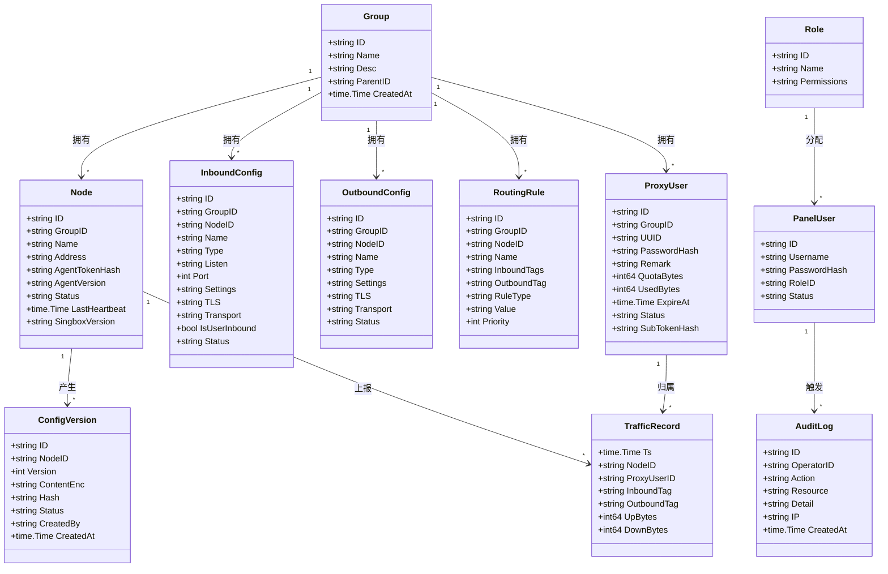
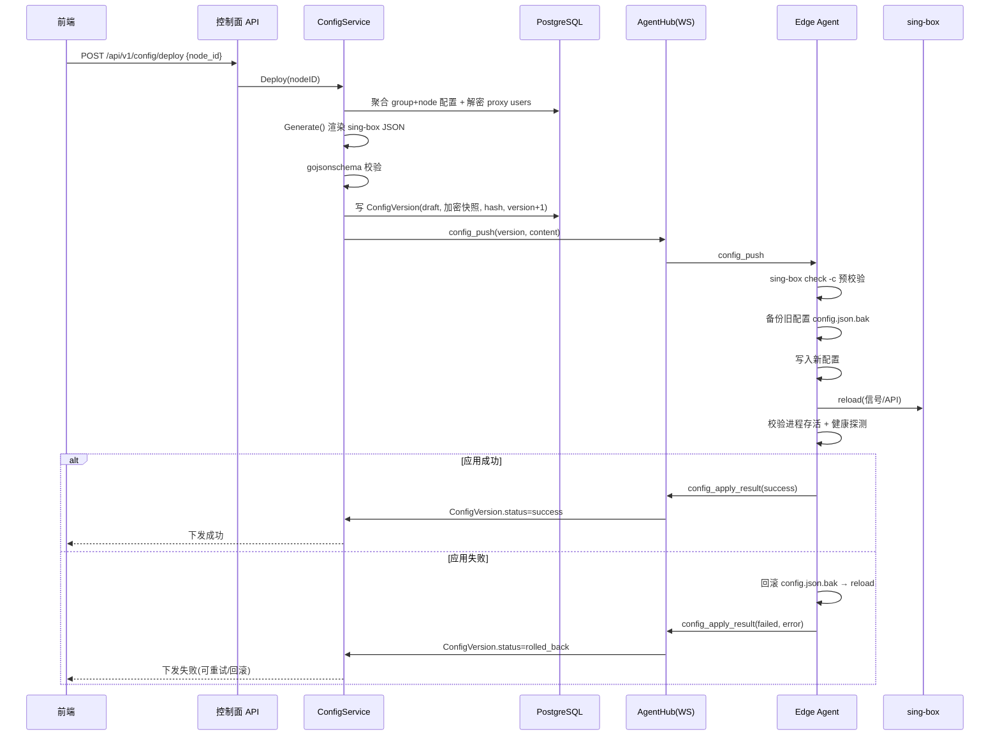
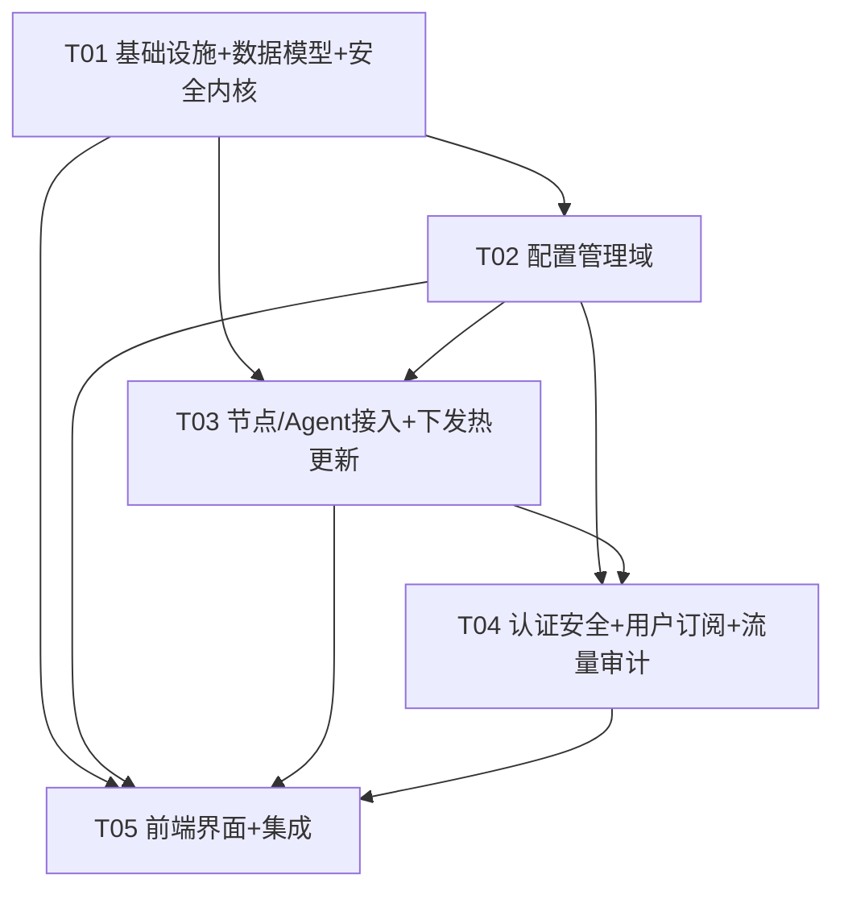

# sing-box 企业级代理服务管理面板 — 系统架构设计 + 任务分解

> 架构师：高见远（Bob）
> 面向对象：工程师（唯一实现依据）
> 范围：控制面（Control Plane）+ 边缘节点 Agent（Edge Agent）+ 前端管理界面

---

## 文档索引

> **单一事实源**：`system_design.md` 是系统设计的唯一事实源；以下需求/增量专题文档与附图是它的输入或专题展开，出现冲突时以本文件为准。

| 文档 | 定位 | 关系 |
|---|---|---|
| `docs/PRD.md` | 产品需求文档 | 需求来源，需求细节以 PRD 为准 |
| `docs/system_design.md` | **主设计（单一事实源）** | 本文档，工程师唯一实现依据 |
| `docs/agent-cross-platform.md` | 增量专题：跨平台 Agent OS 抽象层 | §3.2 摘要挂载，详见本专题 |
| `docs/protocol-matrix-renderer.md` | 增量专题：协议支持矩阵 + 渲染器扩展点 | §3.1/§5.7 摘要挂载，详见本专题 |
| `docs/class-diagram.mermaid` | 附图：实体关系图 | §4.1 的可视化副本 |
| `docs/sequence-diagram.mermaid` | 附图：关键调用时序图 | §5.6/§6 的可视化副本 |

---

## 0. 设计原则速览

1. **内核解耦**：面板自有「中立配置模型」与 sing-box 原生 JSON Schema 完全解耦，通过适配层（Generator + Template）做映射，内核版本演进只改适配层。
2. **控制面无状态**：会话放 Redis，配置/状态落 PostgreSQL，控制面实例可水平扩容（HA 为 P2）。
3. **Agent 轻量 + 主动出站**：Agent 只做「进程托管 + 配置应用 + 流量采集 + 心跳上报」，主动建 WebSocket 长连接，天然穿透 NAT，无入站端口暴露。
4. **敏感信息加密落库**：TLS 私钥 / 证书 / UUID / 订阅令牌 / Agent 令牌等全部 AES-256-GCM 加密或哈希，密钥应用级托管（后续可接 KMS/Vault）。
5. **可回滚**：每次下发生成不可变配置版本（含加密快照），Agent 侧预校验 + 备份 + reload + 失败自动回滚。

---

## 1. 总体架构

### 1.1 架构图

```mermaid
flowchart TB
    subgraph Client["客户端层"]
        WEB["前端管理界面<br/>(React SPA)"]
        USER["终端用户<br/>(订阅客户端)"]
    end

    subgraph CP["控制面 Control Plane（Go/gin，无状态，可水平扩容）"]
        API["API 网关 + 中间件<br/>(JWT / RBAC / 审计 / CORS)"]
        AUTH["认证模块<br/>面板登录 / RBAC"]
        NODE["节点管理模块<br/>节点 CRUD / 令牌"]
        CFG["配置管理模块<br/>inbound / outbound / routing"]
        GEN["配置生成适配层<br/>中立模型 → sing-box JSON"]
        VER["配置版本模块<br/>版本 / 回滚"]
        DEP["下发编排模块<br/>重试 / 回滚"]
        PUSER["代理用户模块"]
        SUB["订阅生成模块"]
        TRAF["流量聚合模块"]
        AUDIT["审计日志模块"]
        HUB["Agent Hub<br/>(WebSocket 长连接中心)"]
    end

    subgraph DATA["数据层"]
        PG[("PostgreSQL 16<br/>业务/配置/版本/审计")]
        RD[("Redis 7<br/>会话 / 心跳 / 缓存")]
        TS[("TimescaleDB<br/>流量时序(P1)"]
    end

    subgraph EDGE["边缘节点 Edge Agent（Go，每节点一个）"]
        CLIENT["WS 客户端<br/>注册 / 心跳 / 重连"]
        APPLY["配置应用器<br/>预校验 / 备份 / reload / 回滚"]
        PROC["sing-box 进程托管<br/>start / stop / reload"]
        STATS["流量采集<br/>sing-box stats API"]
        SB[("sing-box 内核<br/>(外部二进制)")]
    end

    WEB -->|HTTPS + JWT| API
    USER -->|HTTPS| SUB
    API --> AUTH
    API --> NODE --> CFG --> GEN --> VER --> DEP
    API --> PUSER --> SUB --> GEN
    API --> TRAF
    API --> AUDIT
    DEP --> HUB

    HUB <-->|WSS 长连接<br/>Agent 主动出站| CLIENT
    CLIENT --> APPLY --> PROC --> SB
    STATS --> SB
    STATS -->|traffic_report| CLIENT

    AUTH --> PG
    NODE --> PG
    CFG --> PG
    VER --> PG
    AUDIT --> PG
    PUSER --> PG
    TRAF --> TS
    AUTH --> RD
    HUB --> RD
```

### 1.2 两大组件职责

| 组件 | 职责 | 关键约束 |
|---|---|---|
| **控制面 Control Plane** | 认证/RBAC、节点纳管、配置管理与生成、版本/下发编排、订阅、流量聚合、审计 | 无状态；核心 API P95 ≤ 300ms；支持 ≥100 节点、≥10 万代理用户 |
| **边缘 Agent** | 主动注册/心跳、接收配置并应用（预校验/备份/reload/回滚）、托管 sing-box 进程、采集并上报流量 | 轻量；心跳/流量上报延迟 ≤10s；热更新生效 ≤5s；无入站端口 |

### 1.3 通信方式（推荐默认，见 §10）

- **浏览器 ↔ 控制面**：HTTPS + REST + JWT（Bearer）。
- **Agent → 控制面**：Agent 主动出站 **WebSocket 长连接**（`wss://`，令牌鉴权，生产可叠加 mTLS），支持跨 NAT、免开入站端口；消息为 JSON 信封（类型 + 序号 + 数据）。心跳 5s/次，断线指数退避重连。
- **控制面 → Agent**：复用同一条长连接下发（config_push 等），不做反向入站。

---

## 2. 技术选型

| 层次 | 选型 | 理由（结合 Go / sing-box 生态） |
|---|---|---|
| 后端框架 | **gin** | 生态最成熟、中间件丰富（CORS/JWT/Recovery）、路由分组清晰、性能足够 |
| ORM / 迁移 | **GORM + 手写 SQL 迁移** | 开发效率高；迁移用 .sql 保证可审、可回滚 |
| 数据库 | **PostgreSQL 16** | JSONB 存协议细节、事务/外键可靠、可扩展 TimescaleDB；替代 MySQL 在复杂聚合查询上更优 |
| 时序 | **TimescaleDB（P1）** | PostgreSQL 扩展，避免第二套存储，满足「时序聚合」非功能需求；P2 可换 ClickHouse |
| 缓存/会话 | **Redis 7** | 控制面无状态化（会话外置）、心跳状态、下发队列、限流 |
| Agent 通信 | **gorilla/websocket** | 比 gRPC 更易部署调试、易穿透 NAT、支持二进制/文本 JSON；gRPC 作为 P2 备选 |
| sing-box 对接 | **外部二进制 + 子进程托管**（已锁定） | 通过 `sing-box check -c` 预校验、SIGHUP/`sing-box` API 做 reload |
| 配置校验 | **santhosh-tekuri/jsonschema（或 xeipuuv/gojsonschema）** | 对生成的 sing-box JSON 做 Schema 校验，与内核版本解耦 |
| 加密 | **AES-256-GCM**（crypto/aes） | 敏感字段加密落库；密码用 **argon2id**（golang.org/x/crypto） |
| JWT | **golang-jwt/jwt/v5** | 标准、广泛使用 |
| 日志 | **uber-go/zap** | 结构化、高性能、可插 trace_id |
| 配置加载 | **spf13/viper** | 控制面/Agent 统一配置读取 |
| 前端框架 | **Vite + React 18 + TypeScript** | 锁定决策「前后端分离 + 响应式」 |
| UI 组件 | **Ant Design v5** | 管理后台组件全、中后台事实标准 |
| 状态管理 | **zustand** | 轻量、无样板代码，替代 Redux |
| 路由/请求 | **react-router-dom v6 + axios** | 标准组合 |
| ID | **google/uuid (v4)** | 全局唯一，便于分库与外部引用 |

---

## 3. 模块划分

### 3.1 控制面（Go）目录结构

```
control-plane/
├── cmd/server/main.go              # 入口：加载配置、连库、起服务
├── internal/
│   ├── config/                     # viper 配置结构体 + 加载
│   ├── server/                     # HTTP server、路由注册、优雅退出
│   ├── middleware/                 # auth.go / rbac.go / audit.go / cors.go
│   ├── model/                      # 领域模型 struct + 常量（全部实体）
│   ├── store/                      # GORM 连接、Repository 接口与实现
│   ├── crypto/                     # AES-GCM 加解密、argon2id、令牌哈希、密钥管理
│   ├── auth/                       # 面板登录、JWT 签发/刷新
│   ├── rbac/                       # 角色/权限常量 + 校验
│   ├── node/                       # 节点管理、Agent 令牌
│   ├── agent/                      # WS Hub、消息协议、注册/心跳/结果处理
│   ├── configsvc/                  # 配置 CRUD + 生成器 + 校验 + 版本
│   │   ├── entity.go               # inbound/outbound/routing 服务
│   │   ├── generator.go            # 查表分发（renderer.Get）+ 全局结构拼装
│   │   ├── template.go             # 全局结构模板（log/dns/route），收窄职责
│   │   ├── validate.go             # 通用业务校验（tag/端口/引用），协议校验委托 renderer
│   │   ├── schema.go               # JSON Schema 校验（按 type 组装协议片段）
│   │   ├── version.go              # ConfigVersion 管理
│   │   └── renderer/               # ★ 协议渲染器插件包（一协议一渲染器，详见 protocol-matrix-renderer.md）
│   │       ├── renderer.go         #   ProtocolRenderer 接口 + RenderContext + Meta
│   │       ├── registry.go         #   Register/Get/List（init() + map）
│   │       ├── tls.go / transport.go / common.go  # 共享 TLS/传输/通用字段渲染
│   │       └── {vless,vmess,trojan,shadowsocks,hysteria2,tuic,anytls}.go  # 各协议渲染器
│   ├── deploy/                     # 下发编排、重试、回滚
│   ├── user/                       # 代理用户
│   ├── subscribe/                  # 订阅生成（sing-box 原生 / Clash）
│   ├── traffic/                    # 流量上报接收 + 聚合
│   ├── audit/                      # 审计日志
│   └── api/                        # handler 层（REST 路由实现）
├── migrations/                     # *.sql 迁移文件
├── singbox-schema/                 # sing-box JSON Schema 文件
└── go.mod
```

### 3.2 边缘 Agent（Go）目录结构

```
edge-agent/
├── cmd/agent/main.go
├── internal/
│   ├── config/                     # agent 自身配置（控制面地址、令牌、内核版本策略）
│   ├── client/                     # WS 客户端：注册/心跳/重连
│   ├── proc/                       # ★ OS 抽象：ProcessManager/Reloader/Process（屏蔽 Linux/Windows 差异）
│   ├── kernel/                     # ★ 内核版本管理：定位/下载/校验/切换/回滚
│   ├── host/                       # ★ OS/ARCH/libc 探测（register 的 hostinfo）
│   ├── singbox/                    # 内核 supervisor：面向 proc 接口托管生命周期 + check 封装
│   ├── apply/                      # 配置应用：预校验/备份/写文件/Reloader/回滚（统一流程）
│   ├── stats/                      # 流量采集：sing-box stats API → 上报
│   └── secret/                     # 本地令牌安全存储
└── go.mod
```

#### 跨平台 Agent 部署（摘要）

> 详见专题 `docs/agent-cross-platform.md`。核心结论：控制面 Go 单二进制、前端纯浏览器、Agent 交叉编译 + 主动出站 WS → 跨平台天然成立，本小节只补 Agent 侧 OS 抽象封装。

- **进程托管抽象 `internal/proc`**：`ProcessManager`（`Start/Stop/Restart/IsRunning/Wait`）+ `Reloader`（`Reload`）+ `Process` 接口屏蔽 OS 差异，上层 `apply`/`singbox` 只面向接口编程，`runtime.GOOS` 分支全部下沉到 `proc`。
- **reload 语义统一、实现可降级**：上层 `apply` 永远走「预校验 → 备份 → 生效 → 健康探测 → 失败回滚」；「生效」在 Linux/macOS/BSD 是 SIGHUP 热重载（`graceful=true`），在 **Windows 无 SIGHUP，降级为优雅重启**（Stop→Start，`graceful=false`，下发期间秒级抖动，需在节点详情/审计中体现）。
- **孤儿进程零容忍**：Linux `Pdeathsig=SIGTERM`（父死子亡）+ PID 文件对账；Windows Job Object `KILL_ON_JOB_CLOSE` + `run/agent.lock` 防双实例，均不依赖 `defer`。
- **内核版本治理 `internal/kernel`**：二进制由控制面统一下发 + SHA-256 校验，`bin/pool/` 版本池 + `bin/current/` 指针切换，升级/回滚即换指针。
- **交叉编译目标矩阵**（Agent 纯 Go，`CGO_ENABLED=0`）：

| GOOS | GOARCH | 优先级 | 备注 |
|---|---|---|---|
| linux | amd64 / arm64 / arm(v7) | P0 | 主力目标 |
| linux | mips / mipsle | P1 | OpenWrt 软路由，`GOMIPS=softfloat` |
| windows | amd64 / arm64 | P0 | reload 为重启式 |
| darwin / freebsd | amd64 / arm64 | P2 可选 | freebsd 需拍板 |

构建：GoReleaser matrix（产物命名/校验/上传一条龙）或 Makefile 单目标调试构建。

### 3.3 前端模块划分

```
web/
├── index.html / vite.config.ts / tsconfig.json / package.json
└── src/
    ├── main.tsx / App.tsx
    ├── router/index.tsx            # 路由 + 路由守卫
    ├── api/                        # axios 实例 + 各模块接口封装
    ├── store/                      # zustand：auth / node / config / user ...
    ├── components/                 # 通用组件（布局、表格、表单、弹窗）
    ├── pages/
    │   ├── login/                  # 登录
    │   ├── dashboard/              # 概览（节点/流量/告警卡片）
    │   ├── nodes/                  # 节点管理
    │   ├── inbounds/               # Inbound 配置
    │   ├── outbounds/              # Outbound 配置
    │   ├── routing/                # 路由规则
    │   ├── users/                  # 代理用户 + 订阅
    │   ├── traffic/                # 流量统计
    │   ├── audit/                  # 审计日志
    │   └── settings/               # 面板用户 / RBAC
    └── utils/                      # 工具、常量、权限判断
```

---

## 4. 核心数据模型

### 4.1 实体关系图



### 4.2 表结构与敏感字段标注

> 通用约定：主键 `ID` 均为 `UUID v4`；`created_at/updated_at` 默认时间戳；所有时间存 **ISO8601 UTC**。
> 加密标注：🔐=AES-256-GCM 加密落库；#=哈希（不可逆）。

#### group（分组/集群/区域）

| 字段 | 类型 | 说明 | 索引/约束 |
|---|---|---|---|
| id | uuid | 主键 | PK |
| name | varchar(128) | 分组名 | UNIQUE |
| desc | text | 描述 | |
| parent_id | uuid nullable | 父分组（层级隔离，MVP 可空） | INDEX |
| created_at/updated_at | timestamptz | | |

#### node（节点）

| 字段 | 类型 | 说明 | 索引/约束 |
|---|---|---|---|
| id | uuid | 主键 | PK |
| group_id | uuid | 所属分组 | FK→group.id, INDEX |
| name | varchar(128) | 节点名 | |
| address | varchar(255) | 节点公网出口/标识 | |
| agent_token_hash # | varchar(64) | Agent 令牌 SHA-256，仅创建时明文返回一次 | |
| agent_version | varchar(32) | Agent 版本 | |
| singbox_version | varchar(32) | sing-box 内核版本 | |
| status | varchar(16) | online/offline/pending/error | INDEX |
| last_heartbeat | timestamptz | 最近心跳 | INDEX |
| tags | jsonb | 标签 | |

#### inbound_config（Inbound 配置，中立模型）

| 字段 | 类型 | 说明 | 索引/约束 |
|---|---|---|---|
| id | uuid | 主键 | PK |
| group_id | uuid | 归属分组（模板） | FK, INDEX |
| node_id | uuid nullable | 节点级覆盖（空=分组模板） | FK, INDEX |
| name | varchar(64) | 即 sing-box `tag` | UNIQUE(group_id,node_id,name) |
| type | varchar(32) | vmess/vless/trojan/shadowsocks/hysteria2/tuic | |
| listen | varchar(64) | 监听地址 | |
| port | int | 监听端口 | |
| settings | jsonb | 协议参数（clients/users 等） | |
| tls | jsonb | TLS/Reality 配置（🔐 private_key 加密） | |
| transport | jsonb | 传输层配置 | |
| is_user_inbound | bool | 是否为代理用户入口（生成时注入用户 UUID） | |
| status | varchar(16) | enabled/disabled | |

#### outbound_config（Outbound 配置）

| 字段 | 类型 | 说明 | 索引/约束 |
|---|---|---|---|
| id | uuid | 主键 | PK |
| group_id / node_id | uuid | 归属 | FK, INDEX |
| name | varchar(64) | sing-box `tag` | UNIQUE |
| type | varchar(32) | direct/block/selector/urltest/vless/trojan/anytls/... | |
| settings | jsonb | 出站参数（🔐 服务器密码等加密） | |
| tls | jsonb nullable | 出站 TLS/Reality 配置（🔐 private_key 等私钥加密） | |
| transport | jsonb nullable | 出站传输层配置（ws/grpc/httpupgrade 等） | |
| status | varchar(16) | enabled/disabled（默认 enabled） | |

#### routing_rule（路由规则）

| 字段 | 类型 | 说明 | 索引/约束 |
|---|---|---|---|
| id | uuid | 主键 | PK |
| group_id / node_id | uuid | 归属 | FK, INDEX |
| name | varchar(64) | 规则名 | |
| inbound_tags | jsonb | 入站 tag 数组 | |
| outbound_tag | varchar(64) | 目标出站 tag | |
| rule_type | varchar(16) | geosite/geoip/domain/ip/protocol | |
| value | text | 规则值（域名/网段/协议） | |
| priority | int | 顺序 | |

#### proxy_user（代理用户/终端用户）

| 字段 | 类型 | 说明 | 索引/约束 |
|---|---|---|---|
| id | uuid | 主键 | PK |
| group_id | uuid | 归属分组 | FK, INDEX |
| uuid 🔐 | text | vless/vmess 用户 UUID，AES-GCM 加密 | |
| password_hash # | varchar(128) | 协议密码（ss/trojan/hysteria2），argon2id | |
| remark | varchar(255) | 备注 | |
| quota_bytes | bigint | 流量配额（-1=无限） | |
| used_bytes | bigint | 已用流量（聚合缓存） | |
| expire_at | timestamptz nullable | 到期时间 | |
| status | varchar(16) | enabled/disabled/expired | INDEX |
| sub_token_hash # | varchar(64) | 订阅令牌 SHA-256，明文仅创建返回 | INDEX |

#### panel_user（面板用户）

| 字段 | 类型 | 说明 | 索引/约束 |
|---|---|---|---|
| id | uuid | 主键 | PK |
| username | varchar(64) | 登录名 | UNIQUE |
| password_hash # | varchar(128) | argon2id | |
| role_id | uuid | 角色 | FK→role.id, INDEX |
| status | varchar(16) | enabled/disabled | |

#### role（角色）

| 字段 | 类型 | 说明 | 索引/约束 |
|---|---|---|---|
| id | uuid | 主键 | PK |
| name | varchar(64) | 角色名（super_admin/admin/viewer） | UNIQUE |
| permissions | jsonb | 权限码数组 | |

#### config_version（配置版本）

| 字段 | 类型 | 说明 | 索引/约束 |
|---|---|---|---|
| id | uuid | 主键 | PK |
| node_id | uuid | 目标节点 | FK, INDEX |
| version | int | 单调递增版本号 | UNIQUE(node_id,version) |
| content_enc 🔐 | text | 完整 sing-box JSON 快照（AES-GCM 加密） | |
| hash | varchar(64) | 明文 SHA-256 | INDEX |
| status | varchar(16) | draft/deploying/success/failed/rolled_back | |
| created_by | uuid | 操作面板用户 | |
| created_at | timestamptz | | |

#### traffic_record（流量时序，TimescaleDB hypertable）

| 字段 | 类型 | 说明 | 索引/约束 |
|---|---|---|---|
| ts | timestamptz | 时间桶 | PK 组合 |
| node_id | uuid | 节点 | INDEX |
| proxy_user_id | uuid nullable | 代理用户（用户级聚合用 UUID） | INDEX |
| inbound_tag / outbound_tag | varchar(64) | 出入站 tag | |
| up_bytes / down_bytes | bigint | 上行/下行字节 | |

#### audit_log（审计日志）

| 字段 | 类型 | 说明 | 索引/约束 |
|---|---|---|---|
| id | uuid | 主键 | PK |
| operator_id | uuid | 操作者 | INDEX |
| action | varchar(64) | 动作（login/config.deploy/node.delete...） | INDEX |
| resource | varchar(255) | 资源标识 | |
| detail | jsonb | 变更前后快照 | |
| ip | varchar(64) | 来源 IP | |
| created_at | timestamptz | | INDEX |

#### 迁移说明

- `outbound_config` 在既有 `settings` 基础上新增两个 **nullable JSONB** 列：`tls`、`transport`，用于承载出站 TLS/Reality 与传输层配置，与 `inbound_config.tls/transport` 保持对称。
- `outbound_config` 新增 `status varchar(16)` 列（取值 `enabled`/`disabled`，默认 `enabled`），与 `inbound_config.status` 语义一致。
- **GORM AutoMigrate** 会自动补齐这些列（`tls`/`transport` 默认 `NULL`、`status` 默认 `enabled`，向后兼容，已有数据不受影响），**无需手写迁移文件**；若后续引入显式迁移机制，再补充对应脚本，等价语句：
  ```sql
  ALTER TABLE outbound_config
      ADD COLUMN IF NOT EXISTS tls jsonb,
      ADD COLUMN IF NOT EXISTS transport jsonb,
      ADD COLUMN IF NOT EXISTS status varchar(16) NOT NULL DEFAULT 'enabled';
  ```
- 敏感字段加密约定与 `inbound_config.tls` 一致：`tls` 中的私钥类字段（如 Reality `private_key`）AES-256-GCM 加密存储。

---

## 5. 配置生成逻辑（核心）

### 5.1 整体链路

```
可视化/中立模型(DB) ──① 聚合──▶ 完整配置上下文 ──② 渲染模板──▶ sing-box JSON
      ──③ Schema 校验──▶ 生成配置版本 ──④ 下发──▶ Agent 预校验 ──⑤ 备份+写盘
      ──⑥ reload──▶ 健康校验 ──⑦ 成功/失败回滚
```

**关键点**：面板永不直接存储/编辑 sing-box JSON 原文，只存中立模型；JSON 由 `Generator` 纯函数生成，保证「所见即所得」且可被 Schema 校验。

### 5.2 配置上下文（Generator 输入）

生成单节点配置时，组装以下上下文：

```go
type NodeConfigContext struct {
    Global     GlobalSettings     // DNS、log、experimental 等全局
    Inbounds   []InboundConfig    // 分组模板 + 节点覆盖
    Outbounds  []OutboundConfig   // 同上
    Rules      []RoutingRule      // 按 priority 排序
    ProxyUsers []ProxyUser        // 该分组 active 用户（UUID 解密后注入）
}
```

**合并规则**：先取 `group_id` 模板（`node_id IS NULL`），再被该节点 `node_id` 的覆盖项替换（同名覆盖，否则追加）。

**启停过滤**：`Generate()` 前过滤 `status=disabled` 的 inbound/outbound —— disabled 项不写入 `inbounds[]` / `outbounds[]`（与两表 `enabled/disabled` 语义一致）。

### 5.3 渲染模板与 JSON 结构示例

**Inbound — vless + Reality（代理用户入口）**：

```json
{
  "type": "vless",
  "tag": "in-vless-reality",
  "listen": "0.0.0.0",
  "listen_port": 443,
  "users": [
    { "name": "user-8f0a", "uuid": "<解密注入>", "flow": "xtls-rprx-vision" }
  ],
  "tls": {
    "enabled": true,
    "server_name": "example.com",
    "reality": {
      "enabled": true,
      "handshake": { "server": "example.com", "server_port": 443 },
      "private_key": "<解密注入>",
      "short_id": ["abcd1234"]
    }
  },
  "transport": { "type": "tcp" }
}
```

**Outbound — selector / urltest + direct**：

```json
{ "type": "selector", "tag": "select", "outbounds": ["auto", "direct"], "default": "auto" },
{ "type": "urltest", "tag": "auto", "outbounds": ["proxy-hk", "proxy-sg"], "url": "http://www.gstatic.com/generate_204" },
{ "type": "direct", "tag": "direct" }
```

**Outbound — vless + TLS + WS（落地/上游节点）**：

```json
{
  "type": "vless",
  "tag": "proxy-hk",
  "server": "hk.example.com",
  "server_port": 443,
  "uuid": "<解密注入>",
  "tls": { "enabled": true, "server_name": "hk.example.com", "utls": { "enabled": true, "fingerprint": "chrome" } },
  "transport": { "type": "ws", "path": "/ws", "headers": { "Host": "hk.example.com" } }
}
```

**Route**：

```json
{
  "route": {
    "rules": [
      { "inbound": ["in-vless-reality"], "geosite": ["cn"], "outbound": "direct" },
      { "inbound": ["in-vless-reality"], "geoip": ["private"], "outbound": "direct" },
      { "protocol": "dns", "outbound": "dns-out" }
    ],
    "final": "select"
  }
}
```

**DNS（全局）**：

```json
{
  "dns": {
    "servers": [
      { "tag": "dns-remote", "address": "https://1.1.1.1/dns-query" },
      { "tag": "dns-local", "address": "223.5.5.5", "detour": "direct" }
    ],
    "final": "dns-remote"
  }
}
```

### 5.4 中立模型 → sing-box 字段映射表

| 面板字段（中立模型） | sing-box 字段 | 备注 |
|---|---|---|
| inbound.type | inbounds[].type | 直通 |
| inbound.name | inbounds[].tag | **tag 全局唯一** |
| inbound.listen / port | inbounds[].listen / listen_port | |
| inbound.settings.users[].uuid | inbounds[].users[].uuid | 生成时解密注入 |
| inbound.tls.enabled | inbounds[].tls.enabled | |
| inbound.tls.reality.private_key | inbounds[].tls.reality.private_key | 🔐 解密注入 |
| inbound.transport.* | inbounds[].transport.* | |
| outbound.type | outbounds[].type | direct/block/selector/urltest/vless/trojan/anytls/… |
| outbound.settings.server/port | outbounds[].server/server_port | |
| outbound.name | outbounds[].tag | |
| outbound.tls.reality.private_key 等 | outbounds[].tls.* | 🔐 私钥解密注入 |
| outbound.transport.* | outbounds[].transport.* | |
| routing.rule_type + value | route.rules[].{geosite\|geoip\|domain\|ip\|protocol} | 按类型映射 |
| routing.inbound_tags | route.rules[].inbound | jsonb→数组 |
| routing.outbound_tag | route.rules[].outbound | |
| global.dns.* | dns.* | |

### 5.5 三层校验

| 层 | 时机 | 内容 | 失败处理 |
|---|---|---|---|
| **① 保存前业务校验** | `PUT/POST inbound/outbound/routing` | tag 唯一、端口冲突、引用完整性（outbound/inbound tag 必须存在）、必填字段、域名/IP 正则 | 拒绝保存，返回具体错误 |
| **② 生成后 Schema 校验** | `Generate()` 之后、写版本之前 | `gojsonschema` 对照 sing-box JSON Schema 全量校验 | 拒绝生成版本，报错定位字段 |
| **③ Agent 预校验 + reload 校验** | Agent 收到 config_push | `sing-box check -c`（退出码+stderr）；reload 后检查进程存活 + 健康 API | 回滚旧配置并上报 failed |

### 5.6 版本管理与回滚



- **版本号**：每节点 `version` 单调递增，`UNIQUE(node_id, version)`。
- **快照**：全文加密落库（含私钥/UUID），回滚时直接解密写回，避免重新生成导致差异。
- **回滚**：控制面可指定回滚到任意历史版本（重新走 config_push）；Agent 侧失败自动回滚本地备份。

### 5.7 协议支持矩阵与渲染器扩展点（摘要）

> 详见专题 `docs/protocol-matrix-renderer.md`。核心结论：把「中立模型 → sing-box JSON」的翻译从「if/switch 硬编码」升级为「协议渲染器插件化」——**新增协议不改数据模型、不改内核、不改 Generator 主体**。

- **一个协议 = 一个渲染器**：`renderer.ProtocolRenderer` 接口（简版）：
  ```go
  type ProtocolRenderer interface {
      Protocol() string
      RenderInbound(ctx *RenderContext, cfg model.InboundConfig, users []ProxyUser) (map[string]any, error)
      RenderOutbound(ctx *RenderContext, cfg model.OutboundConfig) (map[string]any, error)
      ValidateInbound(cfg model.InboundConfig) error
      ValidateOutbound(cfg model.OutboundConfig) error
      SubscriptionURI(cfg model.OutboundConfig, user ProxyUser) (string, error)
      Meta() ProtocolMeta // 前端动态表单元数据
  }
  ```
  Generator 只做 `renderer.Get(type)` 查表分发 + 全局结构拼装，不感知协议字段；`template.go` 收窄为全局结构（log/dns/route）。
- **协议专属字段全落 JSONB**：`settings`/`tls`/`transport` 是通用容器，新增协议**零迁移**（`type varchar(32)` 无 DB 约束，靠代码白名单）。
- **anytls 落地要点**：`type=anytls` 密码须 **base64 编码**（与 ss 明文/trojan 明文/vless UUID 语义不同）；`padding_scheme` 仅 inbound、会话池三件套 + `client_metadata` 仅 outbound；inbound+outbound **必选普通 TLS，禁 Reality/ECH**。
- **`outbound_config` 已补 `tls`/`transport` 列**（见 §4.2）：出站 TLS/transport 与 inbound 对称，`renderer/tls.go`/`transport.go` 可同时服务两方向。
- **组合约束唯一权威**：协议级 + 协议×TLS 组合校验在渲染器 `ValidateInbound/ValidateOutbound`（服务端，不可绕过）；前端仅消费 `Meta()` 做体验层约束；Generator 只做跨协议全局校验（tag 唯一/引用/端口）。
- **新增协议验收路径**：新增 `renderer/foobar.go` + `init()` 注册 + Meta + 前端枚举 + schema 片段 + 单测后，不改 Generator 主体、不改数据模型即可产出合法 JSON；以 anytls 作为验证用例（约 12~14 文件 / 约 1~1.5 人日）。

---

## 6. 关键接口设计

### 6.1 控制面 REST API（统一前缀 `/api/v1`，返回 `{code, message, data}`）

| 方法 | 路由 | 说明 | 权限 |
|---|---|---|---|
| POST | /auth/login | 登录，返回 JWT | 公开 |
| POST | /auth/refresh | 刷新 token | 公开 |
| GET | /auth/me | 当前用户信息 | 登录 |
| GET/POST | /groups | 分组列表/创建 | admin |
| PUT/DELETE | /groups/:id | 分组更新/删除 | admin |
| GET/POST | /nodes | 节点列表/创建（返回令牌明文一次） | admin |
| PUT/DELETE | /nodes/:id | 节点更新/删除 | admin |
| POST | /nodes/:id/regenerate-token | 重新生成 Agent 令牌 | super_admin |
| POST | /nodes/:id/test | 节点连通测试（P1） | admin |
| GET/POST | /inbounds | 入站列表/创建 | admin |
| PUT/DELETE | /inbounds/:id | 入站更新/删除 | admin |
| GET/POST | /outbounds | 出站列表/创建 | admin |
| PUT/DELETE | /outbounds/:id | 出站更新/删除 | admin |
| GET/POST | /routing | 路由列表/创建 | admin |
| PUT/DELETE | /routing/:id | 路由更新/删除 | admin |
| POST | /config/preview | 生成配置预览（不落版本） | admin |
| POST | /config/deploy | 下发配置到节点 | admin |
| GET | /config/versions?node_id= | 版本列表 | admin/viewer |
| POST | /config/rollback | 回滚到指定版本 | admin |
| GET/POST | /proxy-users | 代理用户列表/创建 | admin |
| PUT/DELETE | /proxy-users/:id | 更新/删除 | admin |
| POST | /proxy-users/:id/reset-sub | 重置订阅令牌 | admin |
| GET | /sub/:token | **订阅拉取（公开，无鉴权）** | 公开 |
| GET | /sub/:token/clash | Clash 格式导出 | 公开 |
| GET | /traffic/nodes | 节点级流量 | viewer |
| GET | /traffic/users | 用户级流量 | viewer |
| GET | /monitor/nodes | 实时监控（P1） | viewer |
| GET/POST | /panel-users | 面板用户管理 | super_admin |
| GET/POST | /roles | 角色管理 | super_admin |
| GET | /audit-logs | 审计日志查询 | viewer |

### 6.2 Agent ↔ 控制面消息类型（WebSocket JSON 信封）

信封：`{"type":"...","id":"uuid","ts":1700000000,"data":{...}}`

| 方向 | type | 说明 |
|---|---|---|
| Agent→控制面 | `register` | 首次/重连注册（token、hostinfo、singbox_version） |
| Agent→控制面 | `heartbeat` | 5s 心跳（含流量摘要） |
| Agent→控制面 | `traffic_report` | 定时/批量流量上报 |
| Agent→控制面 | `config_apply_result` | 下发结果（success/failed + error） |
| Agent→控制面 | `log` | 节点日志回传（P1） |
| 控制面→Agent | `config_push` | 下发配置（version + 全文） |
| 控制面→Agent | `restart` | 重启 sing-box |
| 控制面→Agent | `ping` | 保活探测 |

---

## 7. 任务列表（工程师按序实现）

> 硬约束：共 **5 个任务**，按依赖顺序；每任务包含多个文件；T01 为基础设施。

### T01 — 项目基础设施 + 数据模型 + 安全内核

- **涉及文件**：`control-plane/go.mod`、`cmd/server/main.go`、`internal/config/config.go`、`pkg/logger/logger.go`、`internal/model/*.go`（全部实体+常量）、`internal/store/db.go`、`migrations/*.sql`、`internal/crypto/crypto.go`、`internal/rbac/rbac.go`；`edge-agent/go.mod`、`cmd/agent/main.go`、`internal/config/config.go`、`internal/secret/secret.go`；`web/package.json`、`vite.config.ts`、`tsconfig.json`、`index.html`、`src/main.tsx`、`src/App.tsx`、`src/api/client.ts`、`src/router/index.tsx`
- **依赖**：无
- **验收**：控制面可启动并连库、迁移成功；AES-GCM/argon2id/令牌哈希单测通过；Agent 可启动并加载配置；前端 `npm run dev` 可运行；全局错误码/日志/时间规范落地。

### T02 — 配置管理域（inbound/outbound/routing + 生成适配 + 校验 + 版本）

- **涉及文件**：`internal/configsvc/entity.go`、`generator.go`、`template.go`、`validate.go`、`schema.go`、`version.go`；`internal/configsvc/renderer/renderer.go`、`registry.go`、`tls.go`、`transport.go`、`common.go`、`vless.go`、`vmess.go`、`trojan.go`、`shadowsocks.go`、`hysteria2.go`、`tuic.go`、`anytls.go`、`*_test.go`；`internal/model/constants.go`（协议类型白名单）；`internal/api/inbound.go`、`outbound.go`、`routing.go`、`config_version.go`；`internal/server/router.go`；`singbox-schema/inbound-*.json`、`outbound-*.json`
- **依赖**：T01
- **验收**：inbound/outbound/routing CRUD 可用且业务校验拦截非法输入；`Generate()` 能产出通过 Schema 校验的 sing-box JSON；`preview` 接口返回合法配置；版本号自增、快照加密落库、可列出历史版本；`outbound_config` 含 `tls`/`transport`/`status` 列（AutoMigrate 自动补齐，`status` 默认 `enabled`），出站 TLS/transport 可独立配置并正确渲染到 `outbounds[].tls/transport`；`status=disabled` 的 in/outbound 在生成时被过滤（不写入对应数组）；「新增协议」验收路径可用（新增 `renderer/foobar.go` + `init()` 注册 + Meta + 前端枚举 + schema 片段 + 单测后，不改 Generator 主体/数据模型即可产出合法 JSON，以 anytls 为验证用例）。

### T03 — 节点/Agent 接入 + 配置下发与热更新

- **涉及文件**：`internal/node/service.go`、`internal/agent/hub.go`、`message.go`、`handler.go`、`internal/deploy/orchestrator.go`、`internal/api/node.go`、`deploy.go`；`edge-agent/internal/client/client.go`、`proc/proc.go`、`proc/proc_unix.go`、`proc/proc_windows.go`、`proc/reload.go`、`kernel/manager.go`、`host/host.go`、`singbox/supervisor.go`、`singbox/check.go`、`apply/apply.go`
- **依赖**：T01、T02
- **验收**：节点创建返回令牌；Agent 注册成功（`hostinfo` 含 `os/arch/libc`）、心跳 5s、断线重连；下发→预校验→备份→写盘→reload→健康校验→成功/失败回滚全链路可用；重试与手动回滚生效；节点状态与最近心跳正确更新；Linux SIGHUP 热重载生效 ≤5s 且不中断（`graceful=true`）、Windows 降级优雅重启（`graceful=false`，节点详情/审计可区分）；孤儿进程回收（Linux `kill -9` Agent 后 sing-box 随 Pdeathsig 退出、Windows `taskkill /F` 后由 Job Object 回收）；内核版本切换（下载→SHA-256 校验→激活→健康探测→失败回滚）；交叉编译 CI 至少产出 linux/amd64、linux/arm64、linux/armv7、windows/amd64、windows/arm64 五类二进制；`run/agent.lock` 防双实例。

### T04 — 认证安全 + 代理用户/订阅 + 流量统计 + 审计

- **涉及文件**：`internal/auth/service.go`、`internal/middleware/auth.go`、`rbac.go`、`audit.go`、`internal/user/service.go`、`internal/subscribe/service.go`、`token.go`、`internal/traffic/service.go`、`internal/audit/service.go`、`internal/api/auth.go`、`proxy_user.go`、`subscribe.go`、`traffic.go`、`audit.go`、`panel_user.go`、`role.go`；`edge-agent/internal/stats/stats.go`
- **依赖**：T01、T02、T03（流量依赖 Agent 上报通道）
- **验收**：登录签发 JWT 且中间件鉴权生效；RBAC 越权 100% 拦截；代理用户 CRUD + 订阅 URL 可拉取配置（UUID 解密注入）；流量上报→节点级/用户级聚合可查；敏感操作全部写入审计日志。

### T05 — 前端管理界面 + 端到端集成

- **涉及文件**：`web/src/pages/login|dashboard|nodes|inbounds|outbounds|routing|users|traffic|audit|settings`、`src/store/*.ts`、`src/api/*.ts`、`src/components/*`、`src/utils/*`；`control-plane/internal/middleware/cors.go`、`internal/server/router.go`（最终集成）
- **依赖**：T01（脚手架）；联调依赖 T02/T03/T04
- **验收**：所有页面完成对应 CRUD/查询；端到端主流程（登录→建节点→配 inbound→建用户→下发→查流量→看审计）全程可走通；路由守卫按角色渲染菜单与权限。

### 任务依赖图



> 并行建议：T02 与 T03 中 Agent 侧 `singbox/process.go` 可并行；T05 页面开发可在 T01 后即启动，与 T02–T04 联调后收口。

---

## 8. 依赖包清单

### Go（控制面）

```
- github.com/gin-gonic/gin@^1.9        # Web 框架
- gorm.io/gorm@^1.25                    # ORM
- gorm.io/driver/postgres@^1.5          # PG 驱动
- github.com/golang-jwt/jwt/v5@^5.2     # JWT
- github.com/gorilla/websocket@^1.5     # WS
- github.com/google/uuid@^1.5           # UUID v4
- github.com/spf13/viper@^1.18          # 配置加载
- go.uber.org/zap@^1.26                 # 结构化日志
- golang.org/x/crypto@latest            # argon2id / 辅助
- github.com/santhosh-tekuri/jsonschema/v5  # JSON Schema 校验
- github.com/redis/go-redis/v9@^9.4     # Redis 客户端
```

### Go（Agent）

```
- github.com/gorilla/websocket@^1.5
- github.com/spf13/viper@^1.18
- go.uber.org/zap@^1.26
- github.com/google/uuid@^1.5
- golang.org/x/sys@latest                 # Windows Job Object / syscall 封装（仅 windows 目标编译）
```

> 构建工具（非运行时依赖）：**GoReleaser** 用于 Agent 交叉编译产物矩阵（`.goreleaser.yaml`），`CGO_ENABLED=0` 静态编译。协议渲染器（`configsvc/renderer/`）**无新增第三方依赖**（纯 Go stdlib + 既有依赖）。

### 前端

```
- react@^18.2.0
- react-dom@^18.2.0
- typescript@^5.3
- vite@^5.0
- antd@^5.12
- @ant-design/icons@^5.2
- zustand@^4.4
- react-router-dom@^6.20
- axios@^1.6
- @tanstack/react-query@^5.12   # 可选，服务端状态缓存
```

---

## 9. 共享知识（跨文件约定）

1. **统一响应格式**：所有 API 返回 `{"code":0,"message":"ok","data":{}}`；`code≠0` 为错误，业务码 1xxx 通用、2xxx 认证、3xxx 权限、4xxx 配置、5xxx 节点/Agent。
2. **错误处理**：handler 层统一 `c.JSON`；service 层返回 `error`，用 `errors.Is` 区分业务错误；禁止 panic，`Recovery` 中间件兜底。
3. **日志规范**：zap 结构化；每个请求注入 `trace_id`（中间件生成，贯穿 service 与 Agent 消息）；敏感值（UUID/私钥/令牌）脱敏，永不打印明文。
4. **数据库访问**：一律经 `store` 的 Repository 接口；写操作显式事务；外键约束开启；JSONB 用 `json.RawMessage` 承载。
5. **敏感信息**：入库前统一走 `crypto` 包（🔐 加密 / # 哈希），明文只存在于生成/下发内存链路中。
6. **命名映射约定**：中立模型字段名与 sing-box 字段名的映射集中在 `configsvc/template.go`，其余代码不得硬编码 sing-box 字段名。
7. **ID 与时间**：主键 UUID v4；时间 ISO8601 UTC；`created_at/updated_at` 由 GORM 自动维护。
8. **tag 唯一性**：`inbound.name` / `outbound.name` 在「分组+节点」范围内唯一，并在 `Generate()` 中再次全量断言。
9. **Agent 消息**：一律带 `id`（幂等）+ `ts`；控制面按 `id` 去重；`config_apply_result` 必须回传 `version`。
10. **配置版本**：只追加不修改；下发状态机 `draft→deploying→success|failed→rolled_back`。

---

## 10. 待明确事项（架构师推荐默认方案）

| # | 决策点 | 推荐默认 | 影响 |
|---|---|---|---|
| 1 | Agent 通信方向 | Agent 主动出站 WebSocket 长连接（跨 NAT） | 已按此设计；如需 gRPC 需改造 hub |
| 2 | 流量统计口径 | 节点级真实统计 + 用户级按 UUID 聚合 | 已按此设计 traffic_record |
| 3 | sing-box 版本 | 最新 stable 内核，JSON Schema 适配层兼容 | Schema 文件需随版本维护 |
| 4 | 订阅格式 | sing-box 原生 + Clash 导出 | `sub/:token/clash` 已预留 |
| 5 | 多租户 | MVP 单组织多集群（分组隔离），多租户 P2 | `group.parent_id` 已预留层级 |
| 6 | 认证集成 | MVP 本地账号，SSO/2FA 为 P2 | auth 模块已预留扩展点 |
| 7 | 告警通道 | Webhook + 邮件（P1） | 未纳入 MVP 任务 |
| 8 | 密钥托管 | 自托管加密（应用级密钥，可接 KMS/Vault） | `crypto` 包预留 KeyManager 接口 |
| 9 | 控制面 HA | P2（当前无状态设计已兼容水平扩容） | 需额外 LB + 状态同步 |

**需用户拍板**：① 是否 MVP 引入 TimescaleDB（还是先用 PG 普通表+分区，降低部署复杂度）；② 生产是否要求 Agent 通道 mTLS（默认令牌即可）；③ 前端是否强制使用 Ant Design（默认是）；④ 单节点配置中「代理用户入站」是否固定为一个 `is_user_inbound` 入口（默认是）。
